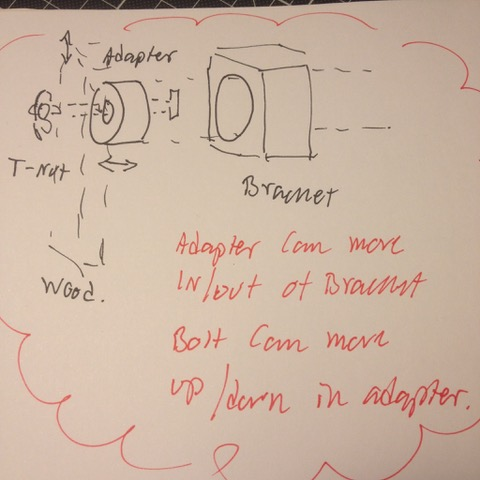

# Todo: Consider possible bracket designs to hang wall tool storage of the studs of my indoor shed (allowing for required adjustments in height and width)?

```#00d6466d``` *As of 2018-12-08 14:27*

[mail plain/text](mail.txt)


It seems I still have not figured out a simple, sturdy and yet adjustable mounting mechanism of the wall tool storages I am making for my indoor shed?

1) Consider a design with an oval shaped stud attachment combined with an oval hole fitted bracket?



> The round or oval shaped adapter can be screwed to the stud with a metric bolt to a T-nut in the stud. The adaptor allows for height adjustment by having the screw travel a slot to allow for height adjustment. The bracket in turn has a hole for the adaptor in which the adaptor can travel sideways to adjust for the width of the object to which the bracket is attached. In this way the idea is that the mechanism allows for adjustment both in height and width. Thus allowing for the mounting T-nuts to be placed in the studs with a sufficient accuracy to matche the adaptor slots. And the wall tool storage width difference in relation to the studs can vary to the degree the bracket can allow for the adaptor to adjust in the adaptor hole. NOTE: This mechanism does NOT allow for adjustment in depth with presumably is of less importance as the whole tool storage may simply be able to travel in and out of the wall to which it is mounted without any great consequences?

2) Consider if we can imagine any “simpler” mounting mechanism that allows for adjustment in width and height by some other travel operation?

==&gt; Consider to design a bracket to be 3D-printed in some “springy” plastic so that the width travel is accomplished by some elastic “tongue” shape?

NOTE: The required travel in width may need to be +%- 2 cm (?) with could require quite a long tongue to keep the plastic from breaking when bending that distance.

NOTE: Consider that a long springy tongue still need to be able to hold the weight of the mounted tool storage (several Kg)?

...


