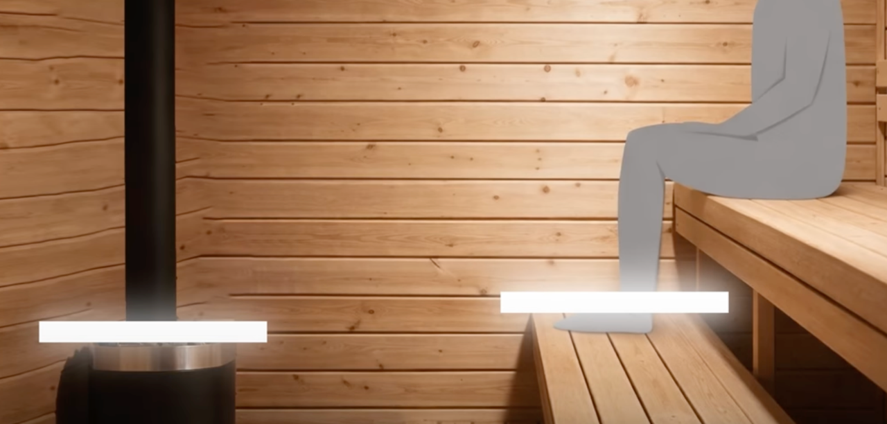
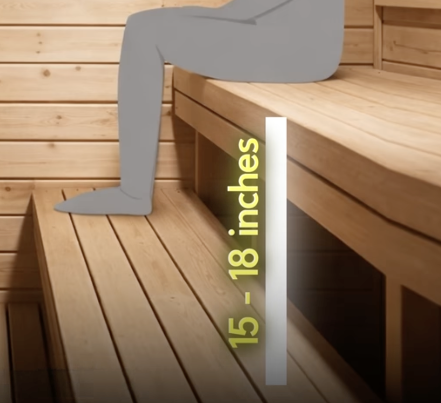
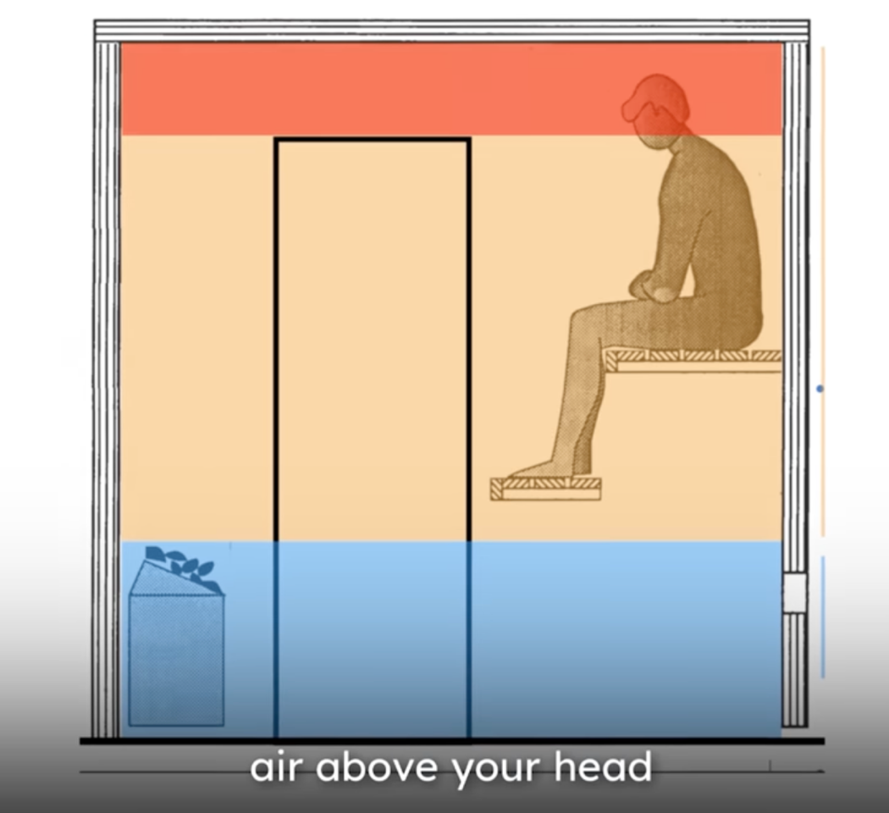
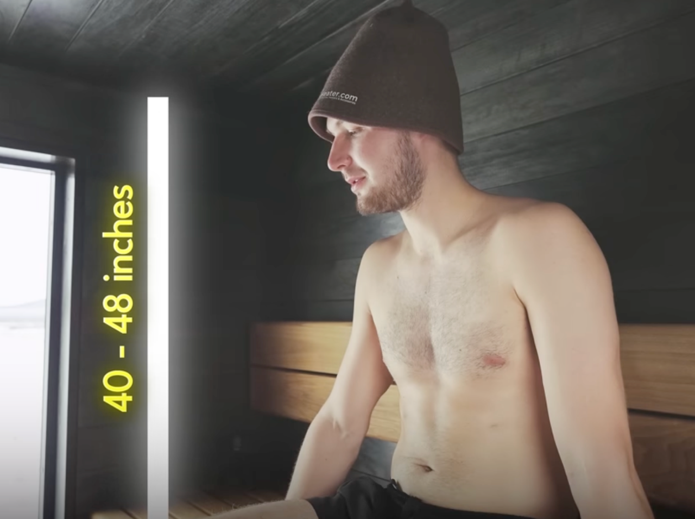

# Todo: Consider the basic measurements and key design requirements for a Finnish Sauna?

```#012b39ec``` *As of 2026-01-21 21:00*

[mail plain/text](mail.txt)


I may one day want to build a Sauna.

1) Consider youtube video "Why Most US Home Saunas Feel Wrong: 4 Rules You Can’t Ignore" (<https://youtu.be/LTrKEf5ilNk> )?

\* Feet above the stones (heating aggregate)



(<https://youtu.be/LTrKEf5ilNk?t=136> )

\* About 40 cm high top bench (for relaxed sitting)



(<https://youtu.be/LTrKEf5ilNk?t=141> )

\* At least two vents for using the sauna (inlet at heating aggregate and outlet under the lavs) (<https://youtu.be/LTrKEf5ilNk?t=184> )

\* An optional drying vent (open after using the sauna)

\* Roof highest point above sitting point ()


(<https://youtu.be/LTrKEf5ilNk?t=347> )

\* 112 cm from top lav and roof





(<https://youtu.be/LTrKEf5ilNk?t=391> )

...


