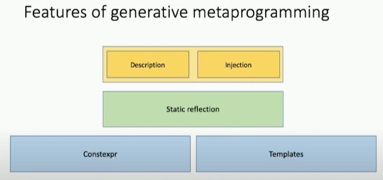
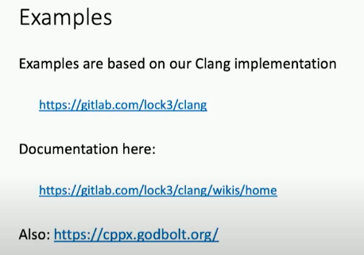

# Todo: Consider to check out Meta++, a Clang C++ implementation of code injection and compare this with my Tha Meta Stack and value semantic shifting?

```#01b0ef96``` *As of 2020-04-28 13:15*

[mail plain/text](mail.txt)


1) Consider the information given in Cppcon 2019 talk "CppCon 2019: Andrew Sutton “Meta++: Language Support for Advanced Generative Programming”" (<https://youtu.be/kjQXhuPX-Ac> )?

> 

>   
> *Some interesting URLs at 9:47 into the video (<https://youtu.be/kjQXhuPX-Ac?t=587> )*

2) This seems to be the home of Lock3 "The Lock3 LLVM Reflection & Metaprograming Clang Fork" at gitlab (<https://gitlab.com/lock3/clang> )?

> *"**This repository contains a modified version of the clang compiler for reflection (feature/reflect) and metaprogramming (feature/metaprogramming).**"*

==&gt; This seems to be the Lock3 wiki with documentation on this project (<https://gitlab.com/lock3/clang/-/wikis/home> )?

> ## Development & Compilation Resources

- [Build Instructions](/lock3/clang/-/wikis/Build-Instructions)
- [Upstream Tracking](/lock3/clang/-/wikis/Upstream-Tracking)

> ## <#tutorials>Tutorials

- [Reflection Introductory Tutorial](/lock3/clang/-/wikis/Reflection-Introductory-Tutorial)
- [Metaprogramming Introductory Tutorial](/lock3/clang/-/wikis/Metaprogramming-Introductory-Tutorial)
- [Contexts for Variadic Reifiers](/lock3/clang/-/wikis/Variadic-Reification)

> ## <#library-documentation>Library Documentation

- [Reflection Library](/lock3/clang/-/wikis/LibDocs/Reflection-Library.pdf)
- [Metaprogramming Extensions](/lock3/clang/-/wikis/LibDocs/Metaprogramming-Extensions.pdf)

> ## <#implementation-information>Implementation Information

- [Library Implementation Details](/lock3/clang/-/wikis/Library-Implementation-Details)


...


