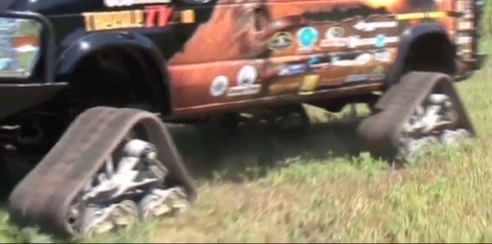
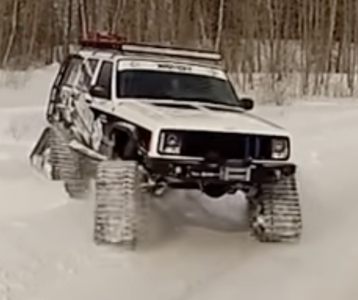
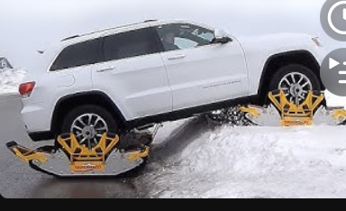

# Todo: Consider a DIY rubber track vehicle (e.g., even my Tesla Y with rubber track conversion kits on the wheels)?

```#022cb6c5``` *As of 2026-01-19 20:34*

[mail plain/text](mail.txt)


If I am to live 'off grid' I may be tempted to trun an ordinary car into a rubber tracked one?

1) Consider 'Mattracks' (<https://youtu.be/d3jrZce9oNo> )?



2) Consider youtube video "Turn Any 4x4 SUV or Light Truck into a Snowmobile in Minutes" (<https://youtu.be/5pqu7nTgs7A> )?



...


