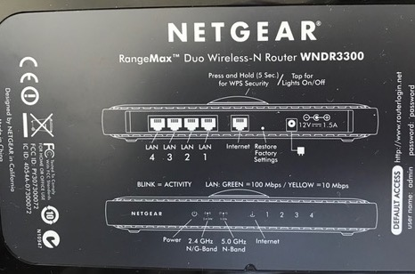
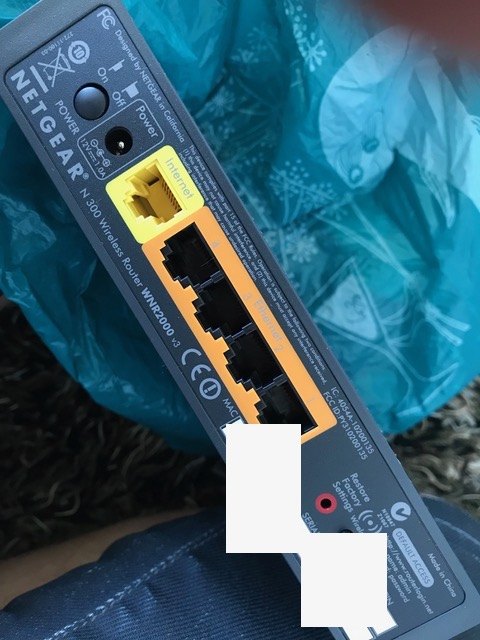

# Todo: Consider ways to monitor (built in or OpenWRT firmware based) internet "consumption" for my new off-grid house (that will probably use mobile internet)?

```#02fbd0ec``` *As of 2019-06-22 17:14*

[mail plain/text](mail.txt)


I need a way to keep track of my internet consumption in my off-grid house to be able to make my internet consumption efficient?

1) Consider to use a router with OpenWRT Linux-based firmware ([https://openwrt.org](https://openwrt.org/) )?

Q: Is there support for network monitoring in MB / period in OpenWRT?

2) Consider possible routers to buy and install OpenWRT on ([https://openwrt.org/toh/views/toh_fwdownload?dataflt%5B0%5D=supported%20current%20rel_%3D18.06.2](https://openwrt.org/toh/views/toh_fwdownload?dataflt[0]=supported%20current%20rel_=18.06.2) )?

3) Consider if I can use my Netgear WNDR3300 (<https://www.netgear.com/support/product/WNDR3300v1.aspx> )?

==&gt; It seems there is a confirmed instruction on how to install the DD-WRT mini through the regular WNDR3300 web UI (<https://openwrt.org/toh/netgear/wndr3300> )?

> "1. Upload this DD-WRT mini through the regular WNDR3300 web UI.

> <http://www.dd-wrt.com/routerdb/de/download/Netgear/WNDR3300/-/dd-wrt.v24_std-wndr3300.chk/2193>

> 2. WNDR3300 will reboot into DD-WRT and be set to default 192.168.1.1."

NOTE: This may or may not be the firmware recommended in the official listing below?

> Suggested: <http://www.dd-wrt.com/routerdb/de/download/Netgear/WNDR3300/-/dd-wrt.v24_std-wndr3300.chk/2193>  
> Official: <http://downloads.openwrt.org/releases/18.06.2/targets/brcm47xx/legacy/openwrt-18.06.2-brcm47xx-legacy-netgear-wndr3300-v1-squashfs.chk>


*The <http://www.dd-wrt.com/routerdb/de/download/Netgear/WNDR3300/-/dd-wrt.v24_std-wndr3300.chk/2193> is a zero byte dms file (does not make any sense)?*

==&gt; In any case - this kind of confirms I can install the OpenWRT firmware though the original NetGear web ui?



==&gt; There seem to be download image for Netgear WNDR3300 on OpenWRT download page (<http://downloads.openwrt.org/releases/18.06.2/targets/brcm47xx/legacy/openwrt-18.06.2-brcm47xx-legacy-netgear-wndr3300-v1-squashfs.chk> )?


*OpenWRT download image available for Netgear WNDR3300 v1*

4) Consider if I can use my Netgear WNR2000 v3 (<https://www.netgear.com/support/product/WNR2000v3> )

==&gt; It seems the Netgear WNR2000 v3 can be instructed through its Web UI to update directly from the correct OpenWRT URL (<https://openwrt.org/toh/netgear/wnr2000> )?

==&gt; But the WNR2000 v3 comes without a Web UI but I can install it with some work (

> "Installing OpenWrt on WNR2000v3
1. Since changeset r45054 from 27.03.2015 OpenWrt can be flashed by using the **built-in updater in the Netgear Web-Gui**:
  - Installing OpenWrt: **Use** <https://downloads.openwrt.org/snapshots/trunk/ar71xx/generic/openwrt-ar71xx-generic-wnr2000v3-squashfs-factory.img> **with built-in updater**. It come without web interface, you must install it (this is a little bit tricky, no free space were available after installation of this firmware)

2. If the built-in updater rejects the image, you can use “tftp2.exe” or similar to flash the device:
  - tfpt2.exe can be downloaded from the instructions provided by Netgear: <http://kb.netgear.com/app/answers/detail/a_id/19841/~/reinstall-the-firmware-on-a-router-without-the-setup-cd-recovery-tool>
  - Prep the router to receive the image: turn off the router, hold down the reset button, turn ON the router (with reset button still pressed), then wait about 10-15 seconds for the light to start flashing green. Once it flashes green at least 10 times, you can release the reset button and the router is ready to receive an image (the device seems to wait forever for an image, so you don't have to hurry).
  - To flash with tftp2.exe: set your computer to a static IP (such as 192.168.1.7) and connect the computer to one of the router's 4 wired-ethernet ports (NOT the WAN port). Open the tftp2.exe program on your computer, set the “Server” to 192.168.1.1, leave “Password” blank, for “File” choose the OpenWrt image, then click “Upgrade”. That's it. After about 2-3 minutes, the image will finalize and you should be able to login to Luci immediately at 192.168.1.1

3. After automatic reboot follow: [checks_and_troubleshooting](https://openwrt.org/docs/guide-quick-start/checks_and_troubleshooting)."



==&gt; There seems to be a download image available for Netgear WNR2000 v3 (<http://downloads.openwrt.org/releases/18.06.2/targets/ar71xx/tiny/openwrt-18.06.2-ar71xx-tiny-wnr2000v3-squashfs-factory.img> )?


*OpenWRT download image available for Netgear WNR2000 v3*

5) Consider to monitor traffic (consumption) with vnstat installed on OpenWRT firmware router (<https://humdi.net/vnstat/> )?


...


