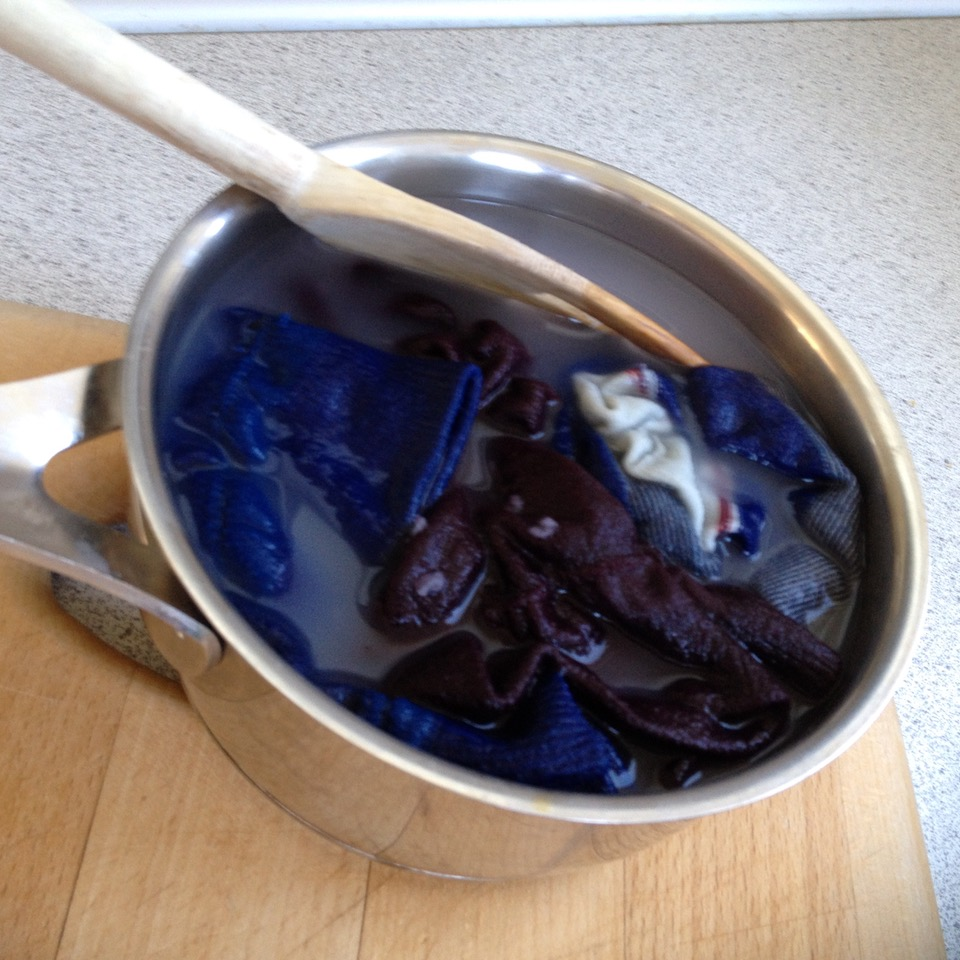
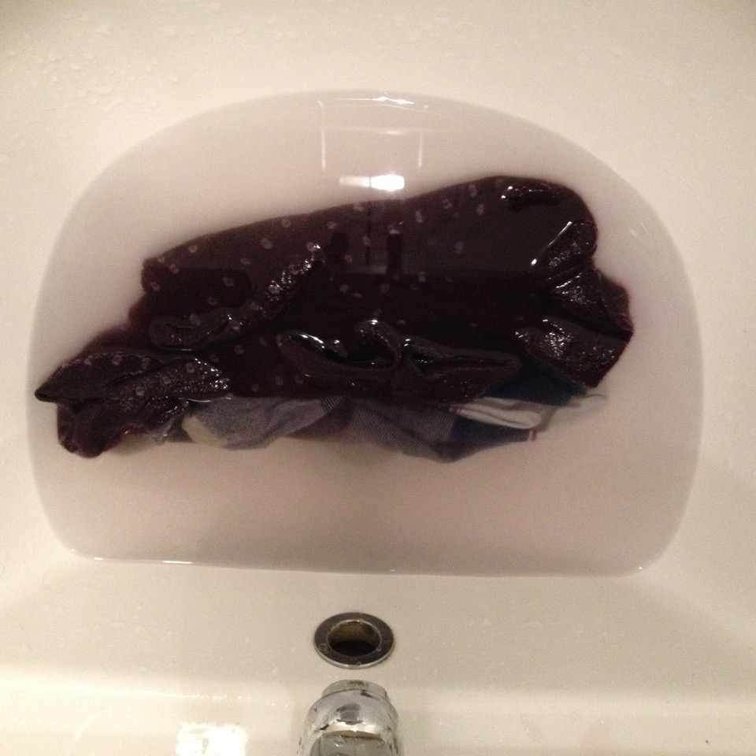

# Todo: Consider tp design and build a prototype of a Micro and Electro Flocculation Rinse Laundring Machine?

```#047072dd``` *As of 2018-05-23 19:53*

[mail plain/text](mail.txt)


1) Consider the Micro Launderer should run on Battery levels of voltage and current and be designed for say two pair of socks, one underwear up to one T-shirt or similar size?

==&gt; Consider to compare or be inspired of this experiment of laundering two pair of socks in 60 degree water and small amount of washing powder?



2) Consider to experiment with rinsing with very small amount of water and flocculation of rinsed out dirt?

==&gt; Consider to do experiment with flocculation (chemical and electro flocculation) of rinse water?

==&gt; Does the “dirt” and washing chemicals even flocculate?

**TODO: Research on and do Experiment with rinse water to determine if and how we can flocculate to re-use rinse water to get laundry free of dirt and washing chemicals?**

==&gt; Consider to compare with or experiment with the dirty water of this manual rinse of two pair of socks in 2L of water?



...


