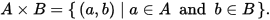
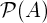
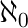
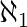
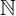
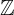

# Todo: Category Theory - Consider I am now coming in to start understanding what Categories, Functors and Functor Transformations are all about?

```#04ac351f``` *As of 2017-08-11 21:13*

[mail plain/text](mail.txt)


It seems I am now one step closer to understand Categories, Functors and Functor Transformations?

1) Consider this lambdaconf talk that actually makes sense to me (<https://www.youtube.com/watch?v=foYT88jdSp8>)?

A **Category** Is: Some Objects X, Y, Z And Arrows between objects that perserve Identity and Composition.

==&gt; Consider what this means when applied to computer science (functional programming)?

==&gt; The Objects are Sets of values (i.e., Types)?

==&gt; The Arrows are functions (maps values of one type to another or same type)

==&gt; A set of Types and functions forms a Category if the functions between those types preserve Identity and Composition.

==&gt; Basically Identity means that all functions f: T1 -&gt; T2 must explicitly map the “Identity value” of T1 to the “Identity Value” of T2

Given types T1, T2, T3

Given functions f: T1 -&gt; T2, g: T2 -&gt; T3.

Compositions g.f

A Functor: Transforms one category to another Category (all objects and all arrows)

==&gt; Consider what this means when applied to computer science (functional programming)?

==&gt; The Objects are Sets of values (i.e., Types)?

==&gt; The Arrows are functions (maps values of one type to another or same type)

==&gt; Thus, a Functor will map ALL objects T1, T2, T3 in Category A to objects U1, U2, U3 in Category B

==&gt; And, it will also map ALL functions f,g,h,… in Category A to functions φ, Ɣ, ξ in category B

We write: F: A -&gt; B // Maps category A to Category B

F A = Objects in B

F f = Functions in B

A Natural Transformation is: A mapping of a Functor F to another Functor G where both F and G maps Category A to Category B

We write:

Natural Transformation α: F =&gt; G // Thick arrow means transformation (compare -&gt; that means map between types i.e., function)

F,G: A -&gt; B // F ad G both maps Category A to Category B

==&gt; At 13:20 he finishes of the explanation of a Monoid with multiplication and Identity (<https://youtu.be/foYT88jdSp8?t=800>)


Multiplication for Types T1 x T2 is defines as the pair (t1, t2)

And the Monoid is defined as the commute diagram relating T, T\*T and T\*T\*T using two reduction functions f1: TxTxT -&gt; TxT and f2: TxT -&gt; T

The tradition is to use M to represent the Monoidal object (the type T in programming)

==&gt; We have two ways to reduce MxMxM to MxM

> > MxMxM --------&gt; (MxM) x M --------&gt; MxM  
> > MxMxM --------&gt; M x (MxM) --------&gt; MxM

==&gt; Here we use the Haskel syntax f &&& g to mean the function composition of “multiplication”

==&gt; Thus, with μ: M x M -&gt; M // multiplication (as fold?)

==&gt; The two ways can be written:

> > MxMxM --------&gt; (μ M M) x (Id M) // Haskel (μ &&& Id) M M M  
> > MxMxM --------&gt; (Id M) x (μ M M) // Haskel (Id &&& μ) M M M

==&gt; And the commute diagram can now be written:

> > Id &&& μ  
> > MxMxM --------------------------------&gt; MxM  
> > | |  
> > | |  
> > | μ &&& Id | μ  
> > | v  
> > MxM --------------------------------&gt; M  
> > μ

==&gt; Which is Monoidal on multiplication because we never leave object M

==&gt; Consider to compare with wikipedia on Monoid (<https://en.wikipedia.org/wiki/Monoid_(category_theory)> )?

> In [category theory](https://en.wikipedia.org/wiki/Category_theory), a **monoid** (or **monoid object**) (*M*, μ, η) in a [monoidal category](https://en.wikipedia.org/wiki/Monoidal_category) (**C**, ⊗, *I*) is an object *M* together with two [morphisms](https://en.wikipedia.org/wiki/Morphism)
- μ: *M* ⊗ *M* → *M* called *multiplication*,
- η: *I* → *M* called *unit*,


==&gt; For Functional Programming where our objects are Sets we get:

> “ *• A monoid object in Set, the category of sets (with the monoidal structure induced by the **Cartesian product)**, is a monoid in the usual* sense."

==&gt; Using Cartesian Product as defined for Sets (<https://en.wikipedia.org/wiki/Cartesian_product>)

> “*That is, for sets A and B, the Cartesian product A × B is the set of all ordered pairs (a, b) where a ∈ A and b ∈ B. Products can be specified using set-builder notation*”

> 

==&gt; It seems for Type objects we can define the Monoid that uses cartesian product to create AND-types?

==&gt; But I am still a little confused how sum-type (type unions) relates to and-types (<https://en.wikipedia.org/wiki/Tagged_union>)?

> “*In computer science, a **tagged union**, also called a variant, variant record, discriminated union, disjoint union, or sum type, is a data structure used to hold a value that could take on several different, but fixed, types. Only one of the types can be in use at any one time, and a tag field explicitly indicates which one is in use. It can be thought of as a type that has several "cases," each of which should be handled correctly when that type is manipulated. Like ordinary unions, tagged unions can* save storage by overlapping storage areas for each type, since only one is in use at a time."

==&gt; Well, Sum types seem to be something called “a dual” of product types?

> “*In type theory, a tagged union is called a sum type. Sum types are the dual of product typ*es."

==&gt; And a “dual” seems to be defined as (

==&gt; An enum seems to be a special degraded form of sum-type?

> “*An enumerated type can be seen as a degenerate case: **a tagged union of unit types.** It corresponds to a set of nullary construc*tors and may be implemented as a simple tag variable, since it holds no additional data besides the value of the tag."

==&gt; Aha - An enum can only be set to any of a fixed set of literals (thus the tag and the value always match 1-to-1, i.e. there is no variable behind the tag)?

==&gt; Compare with the C++ union type that can hold a value of any of the possible held types (the tag identifies current held type and the value of that types may be mutable)?

...

==&gt; This seem to be a good post on the Sum-type (<https://chadaustin.me/2015/07/sum-types/>)?

...

2) Now a Monad in is a special kind of “closed” category (there is no functor to leave the category)

==&gt; Consider a computer programming Monad (A monad of Sets and functions)

==&gt; All functors must map the category to itself so types can only transform between each other (such functors are called endo-functors)

==&gt; And any function composition must preserve an algebra of the source type in the target type.

==&gt; For example, if there is a ‘+’ operator defined for type T1, then any f: T1 -&gt; T2 must perserve the ‘+’ relation between the values in T1 also in T2.

==&gt; I suppose one can understand this as the transformation is loss-less (the algebra holds and may be reversed through some g: T2 -&gt; T1 gets us back)?

==&gt; Thus, a Functor must map all values in T1 to values in T2 and functions on T1 to functions in T2 - keeping the original relations between T1 values and T1 functions intact!

…

3) Consider to bridge mathematical Monad with Functional Programming Monad (a Type Monads) with Tha meta-evaluation (lowering kinds into Types and thus expose their monadic behaviour)?

==&gt; Consider this wikipedia article om Functional Programming Monad (<https://en.wikipedia.org/wiki/Monad_(functional_programming)> )?

==&gt; Note: It may that this page is not entirely correct or fails to use the correct terminology?

> > This article **needs attention from an expert in functional programming**. The specific problem is: **article fails to succinctly explain the topic and excessively relies on references to Haskell-specific terminology, ideas and examples.**

==&gt; Hm… It seems types are not

==&gt; Consider to apply Type Monad definition of a Type System to Tha meta-evaluation (exposing kinds as type monads)?

==&gt; Consider the general definition in Category Theory of a Monad (<https://en.wikipedia.org/wiki/Monad_(category_theory)>)?

4) Consider to use this page as a reference of mathematical grammar (<http://www.rapidtables.com/math/symbols/Basic_Math_Symbols.htm#lnkset>)?

> ## Set theory symbols

> SymbolSymbol NameMeaning / definitionExample{ }seta collection of elementsA = {3,7,9,14},  
> B = {9,14,28}A ∩ Bintersectionobjects that belong to set A and set BA ∩ B = {9,14}A ∪ Bunionobjects that belong to set A or set BA ∪ B = {3,7,9,14,28}A ⊆ BsubsetA is a subset of B. set A is included in set B.{9,14,28} ⊆ {9,14,28}A ⊂ Bproper subset / strict subsetA is a subset of B, but A is not equal to B.{9,14} ⊂ {9,14,28}A ⊄ Bnot subsetset A is not a subset of set B{9,66} ⊄ {9,14,28}A ⊇ BsupersetA is a superset of B. set A includes set B{9,14,28} ⊇ {9,14,28}A ⊃ Bproper superset / strict supersetA is a superset of B, but B is not equal to A.{9,14,28} ⊃ {9,14}A ⊅ Bnot supersetset A is not a superset of set B{9,14,28} ⊅ {9,66}2Apower setall subsets of A power setall subsets of A A = Bequalityboth sets have the same membersA={3,9,14},  
> B={3,9,14},  
> A=BAccomplementall the objects that do not belong to set A A \\ Brelative complementobjects that belong to A and not to BA = {3,9,14},  
> B = {1,2,3},  
> A-B = {9,14}A - Brelative complementobjects that belong to A and not to BA = {3,9,14},  
> B = {1,2,3},  
> A-B = {9,14}A ∆ Bsymmetric differenceobjects that belong to A or B but not to their intersectionA = {3,9,14},  
> B = {1,2,3},  
> A ∆ B = {1,2,9,14}A ⊖ Bsymmetric differenceobjects that belong to A or B but not to their intersectionA = {3,9,14},  
> B = {1,2,3},  
> A ⊖ B = {1,2,9,14}*a*∈Aelement ofset membership A={3,9,14}, 3 ∈ A*x*∉Anot element ofno set membershipA={3,9,14}, 1 ∉ A(*a*,*b*)ordered paircollection of 2 elements A×Bcartesian productset of all ordered pairs from A and B |A|cardinalitythe number of elements of set AA={3,9,14}, |A|=3#Acardinalitythe number of elements of set AA={3,9,14}, #A=3aleph-nullinfinite cardinality of natural numbers set aleph-onecardinality of countable ordinal numbers set Øempty setØ = { }C = {Ø}universal setset of all possible values 0natural numbers / whole numbers set (with zero)0 = {0,1,2,3,4,...}0 ∈ 01natural numbers / whole numbers set (without zero)1 = {1,2,3,4,5,...}6 ∈ 1integer numbers set = {...-3,-2,-1,0,1,2,3,...}-6 ∈ rational numbers set = {*x *| *x*=*a*/*b*, *a*,*b*∈}2/6 ∈ real numbers set = {*x* | -∞ &lt; *x *&lt;∞}6.343434∈complex numbers set = {*z *| *z=a*+*bi*, -∞&lt;*a*&lt;∞, -∞&lt;*b*&lt;∞}6+2*i* ∈ 

…

…

Well, consider to continue on this Todo or write a new one to delve deeper into Functional Programing patterns (especially to get the Tha type system really powerful and correct)?

...


