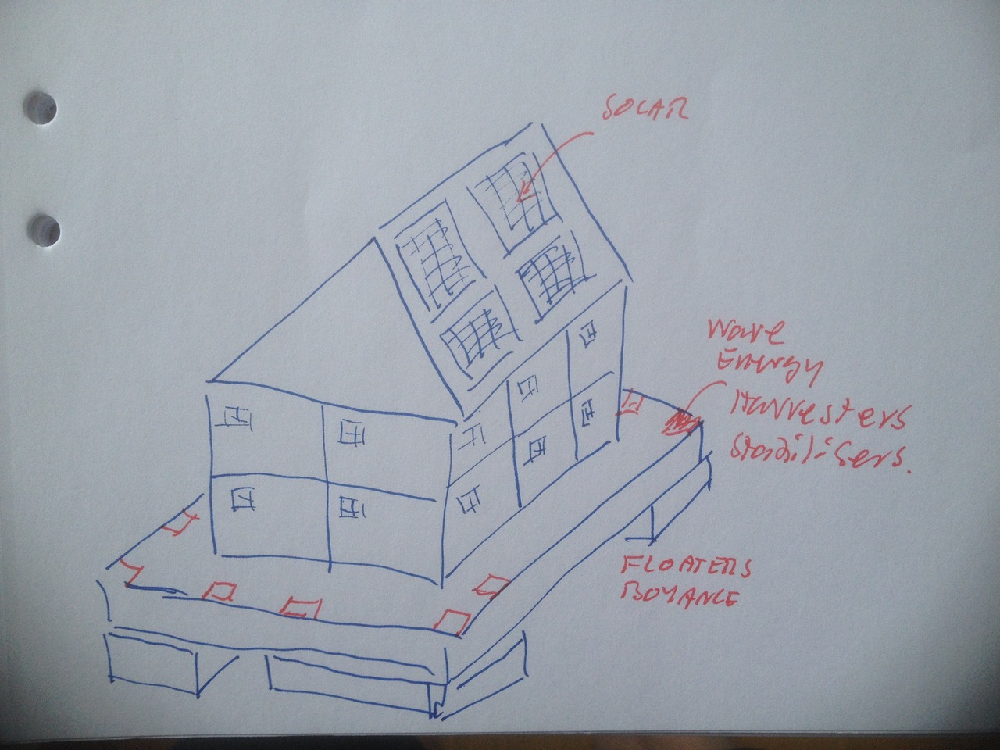

# Todo: Consider to design and build a house boat with all the best and whistles of modern sustainable off-grid technology living?

```#07c6b3d6``` *As of 2018-05-04 16:55*

[mail plain/text](mail.txt)


Could it be a good idea to design a house boat for my next living that has all the bells and whistles of sustainable off-grid living?

1) Consider a house boat with a green-house outer shell, solar panels and wave-energy harvesters and house stabilisers?



==&gt; Consider the outer shell is a durable green-house (i.e., glass)?

==&gt; Consider it floats on extendable and retractable buoyancy floaters attached to the house platform with electric stabilisers and wave-energy harvesters?

==&gt; I.e., when anchored the house platform is raised and the stabilisers absorbs any waves and turns execs energy into electricity?

==&gt; Consider the house has solar panels on the roof?

2) Consider to design the boat so that it rotates when anchored so that the solar panels are always facing the sun?

==&gt; It should be able to design anchor fasteners that can move along the sides of the house platform so the the whole house rotates (in effect making the solar panels always face the sun)?

...


