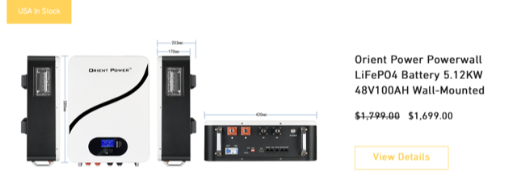
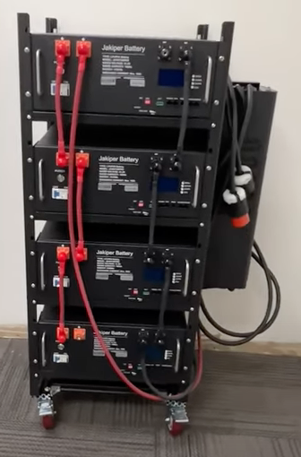
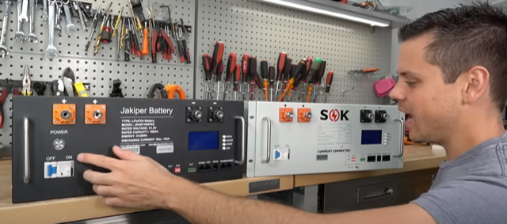

# Todo: Consider to follow Jakiper (Orient Power) "power wall" Battery modules for future off-grid electrical system?

```#09315c99``` *As of 2022-07-19 00:01*

[mail plain/text](mail.txt)


I need some trusted way to design and build an electrical power storage system.

==&gt; Also see "Todo: Consider to follow SOK "power wall" Battery modules for future off-grid electrical system?"

1) This seems to be the home of Jakiper batteries (<https://jakiperbattery.com> )?

==&gt; It seems they sell to Sweden through this site (<https://www.opsolarbattery.com/shop> )?



*It seems they are stocked and delivered from USA?*

2) Consider youtube video "Quick Easy 20Kwh Home Battery system by Jakiper" that shows a complete DIY assembly of a Jakiper battery rack module system (<https://youtu.be/cnna6UXIoaM> )?



*A 4 x 5 KWh = 20 KWh Jakiper modules rack system (with third party inverter on the side) *

3) Consider youtube video "$1,699 Jakiper "Pro" LiFePO4 Battery" that shows the Jakiper battery modules to a a SOK clone (<https://youtu.be/SCjxksZ59ZU> )?



==&gt; It seems the good thing with these modules are that they are user serviceable?

...


