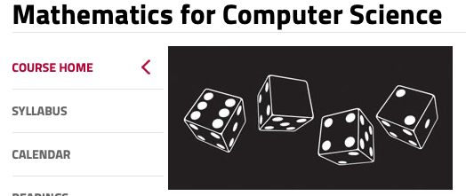

# Todo: Consider the MIT Open course Ware "Mathematics for Computer Science" video lectures and assignments (as follow up on Advent Of Code) :)

```#0955e52c``` *As of 2021-01-15 22:17*

[mail plain/text](mail.txt)


1) Consider this youtube video "Is it possible? Simple questions, not so simple solutions" where the MIT Open Course Ware is referred (<https://youtu.be/PbJaOaXthhk?t=214> )?

2) This seems to be the URL to the MIT "Mathematics for Computer Science" open course (<https://ocw.mit.edu/courses/electrical-engineering-and-computer-science/6-042j-mathematics-for-computer-science-fall-2010/index.htm> )?

> 

> 

3) The video lectures for the MIT "Mathematics for Computer Science" open course seems to live here (<https://ocw.mit.edu/courses/electrical-engineering-and-computer-science/6-042j-mathematics-for-computer-science-fall-2010/video-lectures/> )?

4) The assignments for MIT "Mathematics for Computer Science" seems to live as pdf:s here (<https://ocw.mit.edu/courses/electrical-engineering-and-computer-science/6-042j-mathematics-for-computer-science-fall-2010/assignments/> )

> ASSN #PROBLEM SETS1([PDF](https://ocw.mit.edu/courses/electrical-engineering-and-computer-science/6-042j-mathematics-for-computer-science-fall-2010/assignments/MIT6_042JF10_assn01.pdf))2([PDF](https://ocw.mit.edu/courses/electrical-engineering-and-computer-science/6-042j-mathematics-for-computer-science-fall-2010/assignments/MIT6_042JF10_assn02.pdf))3([PDF](https://ocw.mit.edu/courses/electrical-engineering-and-computer-science/6-042j-mathematics-for-computer-science-fall-2010/assignments/MIT6_042JF10_assn03.pdf))4([PDF](https://ocw.mit.edu/courses/electrical-engineering-and-computer-science/6-042j-mathematics-for-computer-science-fall-2010/assignments/MIT6_042JF10_assn04.pdf))5([PDF](https://ocw.mit.edu/courses/electrical-engineering-and-computer-science/6-042j-mathematics-for-computer-science-fall-2010/assignments/MIT6_042JF10_assn05.pdf))6([PDF](https://ocw.mit.edu/courses/electrical-engineering-and-computer-science/6-042j-mathematics-for-computer-science-fall-2010/assignments/MIT6_042JF10_assn06.pdf))7([PDF](https://ocw.mit.edu/courses/electrical-engineering-and-computer-science/6-042j-mathematics-for-computer-science-fall-2010/assignments/MIT6_042JF10_assn07.pdf))8([PDF](https://ocw.mit.edu/courses/electrical-engineering-and-computer-science/6-042j-mathematics-for-computer-science-fall-2010/assignments/MIT6_042JF10_assn08.pdf))9([PDF](https://ocw.mit.edu/courses/electrical-engineering-and-computer-science/6-042j-mathematics-for-computer-science-fall-2010/assignments/MIT6_042JF10_assn09.pdf))10([PDF](https://ocw.mit.edu/courses/electrical-engineering-and-computer-science/6-042j-mathematics-for-computer-science-fall-2010/assignments/MIT6_042JF10_assn10.pdf))11([PDF](https://ocw.mit.edu/courses/electrical-engineering-and-computer-science/6-042j-mathematics-for-computer-science-fall-2010/assignments/MIT6_042JF10_assn11.pdf))12([PDF](https://ocw.mit.edu/courses/electrical-engineering-and-computer-science/6-042j-mathematics-for-computer-science-fall-2010/assignments/MIT6_042JF10_assn12.pdf))

...


