# Todo: Consider the small part storage system by MySortimo for my electronics labb and future maker space?

```#09591361``` *As of 2024-03-13 10:21*

[mail plain/text](mail.txt)


I need some consistent and "composable" way to organise all the small components and parts of my electronics labb.

0) Consider some base observations and considerations for using MySortimo solutions for my small labb?

> *it seems for my lab with shelf depth limited to 300 mm end below ALL the MySortimo solutions are too deep?*

> *At least, I have yet to find any storage component that can fit on a 300 mm shelf, let alone a 200 or 100 mm one? *

1) Consider the organisation system by MySortimo (<https://www.mysortimo.se/sv_SE/produkter/verktygsforvaring> )?

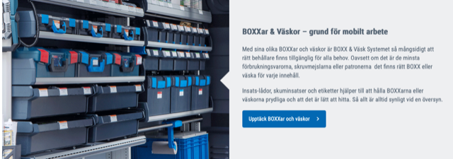

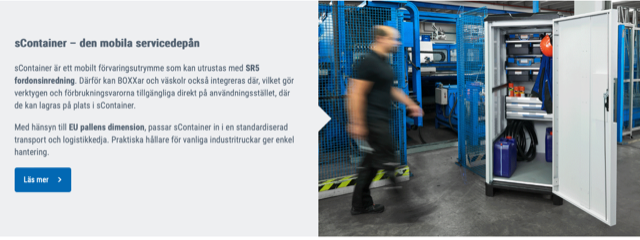

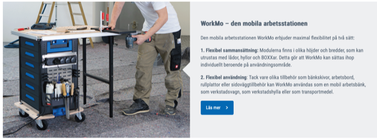

2) Consider I can maybe hang MySortimo boxes "on the wall" and unhook to access?

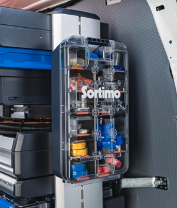

3) Consider to understand the naming of MySortimo product lines?

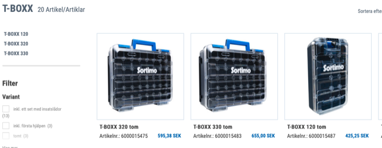

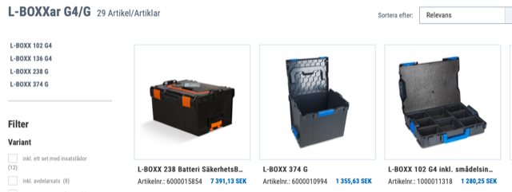

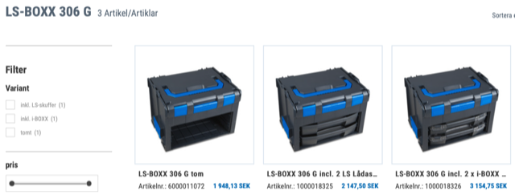

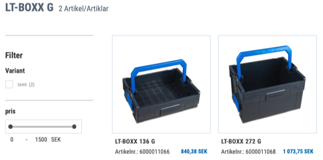

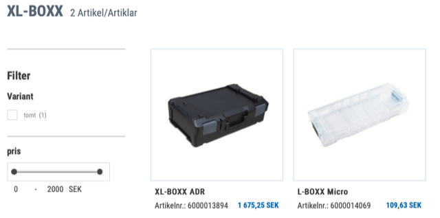

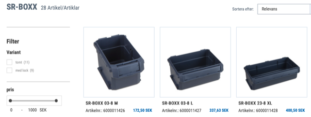

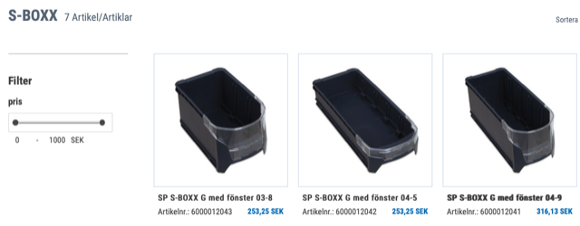

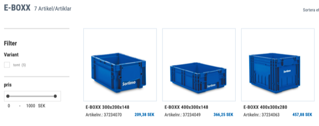

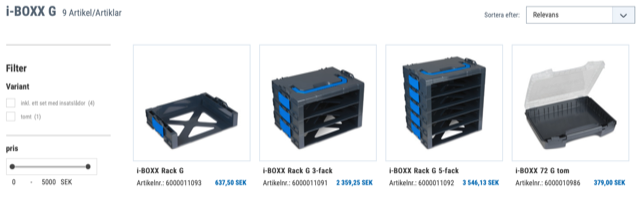

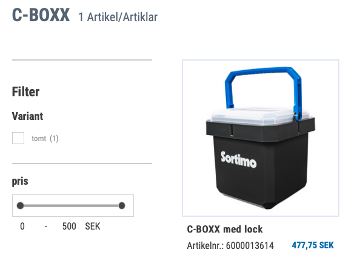

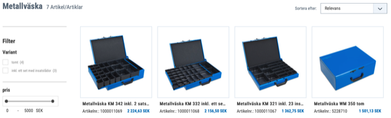

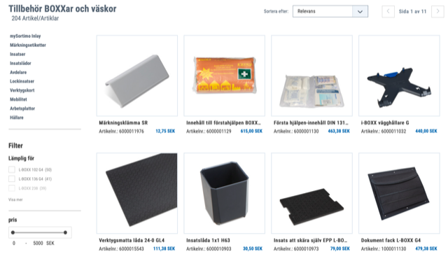

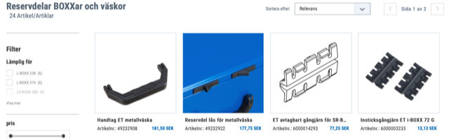

...


