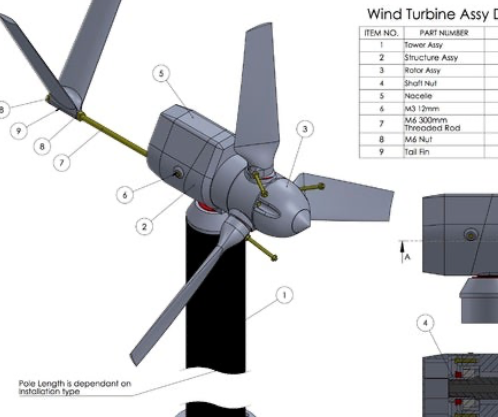
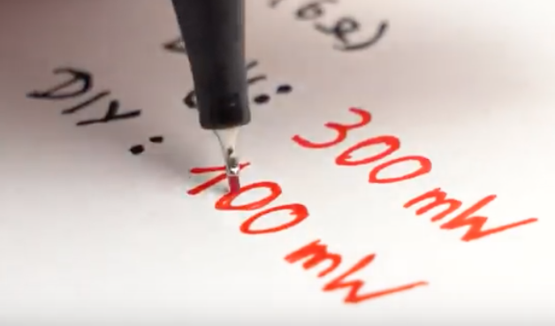
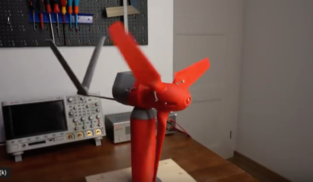

# Todo: Consider to study the "MKII 5 Watt 3d printable Wind Turbine" as tried out by GreatScott! youtube video?

```#0a63b71d``` *As of 2020-03-02 13:15*

[mail plain/text](mail.txt)


I want to utilise wind energy and a DIY wind turbine could be the way to get started?

1) The "MKII 5 Watt 3d printable Wind Turbine" seems to live here on Thingiverse (<https://www.thingiverse.com/thing:2060281> )?

==&gt; It seems to be designe for DIY manufacturing and produces up to 5W at 5 m/s wind?

> "*This fully functional wind turbine has been specifically design to be manufactured, assembled and operated at home with its unique 3d printable design. The wind turbine is optimized to produce a power output of 5 Watt (12volt ~0.4amps) at 5m/s wind speeds, perfect for battery charging applications.*"

> 

==&gt; It seems to be 3D printable using PLA plastic?

> *The turbine components have been designed for Additive Layer Manufacturing (ALM) methods using PLA plastic and 95% of the components require no post processing...*

==&gt; It seems GreatScott! was able to generate 100 mW with a leaf blower and a small stepper motor as generator?

> 

2) Consider the GreatScott! youtube video "" where he builds and tests the "MKII 5 Watt 3d printable Wind Turbine" (<https://youtu.be/938dTRrwrYc> )?

> 

3) Also consider the larger "MKIII 50 Watt 3d printable Wind Turbine" that seems to live here on thingiverse (<https://www.thingiverse.com/thing:2851306> )?

==&gt; It seems to be 3D printable using PLA plastic?

> *The turbine components have been designed for Additive Layer Manufacturing (ALM) methods using PLA plastic and 95% of the components require no post processing...*

...


