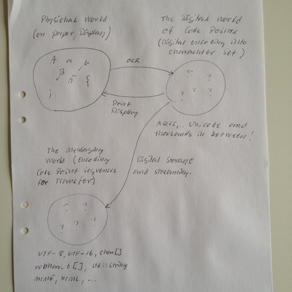

# Todo: Programming - Consider to design a String "type" that bridges text "meaning" and text encoding?

```#0ada7e65``` *As of 2016-04-04 13:20*

[mail plain/text](mail.txt)


It seems we may need to define not an Encode-Aware string type but a Text Meaning-to-encoding bridge class?

See “Todo: Programming - Consider to implement Encoding Aware String types based on C++ Template runtime zero-overhead Metafunctionality?”  
See “Todo: Consider to write and distribute a white-paper on character-set-encodings in Payment System Messaging? “  
See “Todo: Programming - Consider to note that Character-set encoding is a special but strong part of Protocol Message Encodings?"  
See “Todo: Consider to refactor encoding-aware string types as "dimension aware" meta-data?"

1) Consider that as long as a text encoding is the same as its meaning (e.g. in ASCII) current string classes work well?

2) But as soon as the text carries characters that are not in the 0…127 range of values we get problems (meaning differs from encoding)

3) In fact - as soon as encoding changes the “sameness” of two texts will go undetected if there encodings differs?

4) Thus, we should imagine encapsulating string in meaning-to-encoding-aware types?

==&gt; The meaning can be determined by decoding to a common Code Point Set (e.g. ASCII…Unicode)?

5) Consider text “sameness” to be implemented using Niebler Range View Adaptors to a common set of Code Points?

==&gt; Two Strings of different encodings may be compared by checking if they match when adapted and compared in the same Code Point “universe” (e.g. ASCII or Unicode)?

6) Consider if current code strcmp, operator== and similar searches for “sameness” in meaning or in encoding?

==&gt; Can we argue that most often we are after sameness in “meaning”?  
==&gt; But then again, how do we detect cases where it is sameness in encoding the code seeks for?

==&gt; Can we solve this by having our new bridge-class provide different semantics for the two cases (the programmer must specify)?  
==&gt; Can we use template-magic to collapse such semantic differences to zero-overhead if adaptation is not required (same compile-time encoding or run-time Code Set Range)?  
…

7) Consider to delve into C++ GSL (Guidelines Support Library <https://github.com/Microsoft/GSL>) Proposal to enhance string handling with string views (e.g. 22:50 into <https://channel9.msdn.com/Events/CPP/CppCon-2015/Writing-Good-C14-By-Default>)?


==&gt; Consider how the listed string types on the left handled operator== regarding the string “meaning”?

==&gt; Which ones assumes an implicit encoding (UTF, end-sentilen, endinaess)?

==&gt; I hink BSTR asumes null-terminated UTF-16?

==&gt; I think UnicodeString assumes length defined UTF-16?

==&gt; I think std::wstring, wchar_t\* means nothing in itself?

==&gt; I think wchar_t\* passed to windows API assumes null-terminated UTF-16?

...

8) Consider to delve into what registered character sets are defined for web protocols (<https://www.w3.org/International/articles/http-charset/index#charset>)?

==&gt; The IANA seem to define the following registered and named character sets (<http://www.iana.org/assignments/character-sets/character-sets.xhtml>)

==&gt; IANA seem to define a character set here (<http://tools.ietf.org/html/rfc2978>)?

9) Consider we have three “worlds” to bridge (the physical, the Code Point and the Encoding ones)?



==&gt; (1) The physical world is about what we read on a display, on paper or what have you?

==&gt; Sequence of physical graphical symbols?

==&gt; Consider this site to view browser mapping of Unicode Code Points to Display “IRL world” (<http://www.charbase.com/block>)?

==&gt; (2) The Code Point world 8Character Set) where we designate a Code Point to each physical character of interest.

==&gt; Sequence of Code Points?

==&gt; (3) The Process and Transfer world (Value Encoding)where we decide on how to store, process and transfer sequences of Code Points?

==&gt; Sequence of Code Units

==&gt; We thus have

&#91;graphical symbol sequence&#93; &lt;—&gt; &#91;Code Point Sequence&#93; &lt;—&gt; &#91;Code Unit Sequence&#93;

Paper/Display… Character Set Encoding

|  |

|----------------------|

|

**Text&lt;Set,Encoding&gt;**

==&gt; Consider a Text class that pairs the Character Set Representation with the Storage Representation to enable Text visualisation, processing and transfer?

10) Consider to default to use Unicode as the “bridging Code Point Space” (<http://unicode.org>)?

==&gt; Consider to use this site to find mappings of Unicode characters made by the browser (<http://www.charbase.com/block>)?

11) Consider the proposed “bridge” Text&lt;&gt; class to be able to cooperate with ice c++ library (<http://site.icu-project.org>)?

...

…

Consider to delve into this idea of defining a meaning-to-encoding string bridging classes


