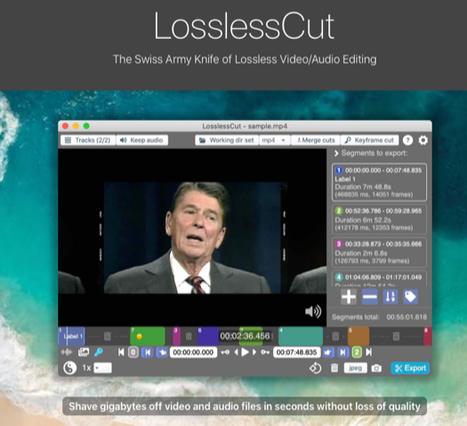

# Todo: Consider to switch from JoyShare Media Cutter to LosslessCut for my video recording tool chain to pre-cut recorded video to store only what I can use?

```#0aeb0321``` *As of 2020-11-10 23:32*

[mail plain/text](mail.txt)


1) LosslessCut seems to live here on Github (<https://github.com/mifi/lossless-cut> )?

==&gt; It seems I can download a pre-built binary for Mac OS for free (<https://github.com/mifi/lossless-cut/releases/latest/download/LosslessCut-mac.dmg> )?

2) It seems LosslessCut has this dedicated home page (<https://mifi.no/losslesscut/> )?

>   
> *The LosslessCut app to cut video at key-frames to NOT re-encode clips*

3) It seems I can "donate" by buying LosslessCut from Apple app-store (<https://apps.apple.com/app/id1505323402> )?

4) Consider this youtube video showing februari 2020 release features (<https://youtu.be/IPQymOSei_Q> )?

...


