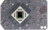
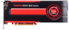
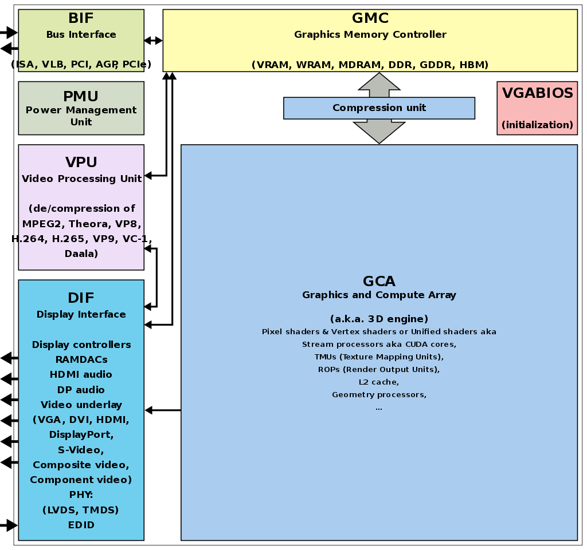
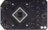
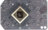
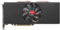
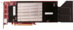
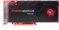

# Todo: Mac Pro 2013 - Consider to understand the Dual AMD D700 graphics cards in the Mac pro 2013?

```#0b3ff437``` *As of 2019-03-07 14:27*

[mail plain/text](mail.txt)


Ok, it's mar 2019 so the late 2013 AMD D700 graphics cards are 5 years and then some. What are they and how do they compare?

1) Consider good sources to understand what the ADM D700 is?

==&gt; Consider techpowerup on the FirePro D700 (<https://www.techpowerup.com/gpu-specs/firepro-d700.c2555> )?

==&gt; It seems strange Apple states the D700 supports up to 6 thunderbolt or LED cinema 27" displays or tree 4k displays so why do this page mark these resolutions in yellow and red?


> "The FirePro D700 was a professional graphics card by AMD, launched in January 2014. Built on the 28 nm process, and based on the Tahiti graphics processor, in its Tahiti XT GL variant, the card supports DirectX 12.0. The Tahiti graphics processor is a large chip with a die area of 352 mm² and 4,313 million transistors. It features 2048 shading units, 128 texture mapping units and 32 ROPs. AMD has placed 6,144 MB GDDR5 memory on the card, which are connected using a 384-bit memory interface. The GPU is operating at a frequency of 850 MHz, memory is running at 1370 MHz.  
> Being a dual-slot card, its power draw is rated at 274 W maximum. Display outputs include: 6x mini-DisplayPort, 1x SDI. FirePro D700 is connected to the rest of the system using a PCI-Express 3.0 x16 interface. The card measures 279 mm in length, and features a dual-slot cooling solution."

==&gt; The D700 seems to use a Tahiti XT GL GPU?


> "Architecture Codename: Southern Islands  
> CLRX Version: GCN 1.0  
> Graphics/Compute: GFX6 (gfx600)  
> Display Core Engine: 6.0  
> Unified Video Decoder: 3.2  
> Video Compression Engine: 1.0

> Exact Transistor Count: 4,312,711,873"

 

*Consider the D700 is listed as 1 : 2.49 to vega 56 and 1 : 3.5 to radeon VII? Consider the D700 is listed as 1 : 1.64 relative the newer radeon RX 570?*

==&gt; Consider the graphics benchmarks of Mac Pro 2013 (D700) and iMac Pro (Vega 56) (<https://512pixels.net/2018/05/the-2013-mac-pro-five-years-later/> )?

==&gt; Consider the GFXBench Metal Benchmark (<https://gfxbench.com/result.jsp?benchmark=gfx50&test=759&text-filter=D700&order=median&ff-desktop=true&os-OS_X_metal=true&pu-dGPU=true&pu-iGPU=true&pu-GPU=true&arch-x86=true&base=gpu> )?


*It is clear that Vega 56 crushes the D700 in GFXBench Metal texturing (32 777 relative 136 249 i.e., roughly 1 : 4 in performance)*


*It is clear that Vega 56 crushes D700 in Aztecs Ruins game (42 fps vs 153 fps i.e., 1 : 3.6 in performance)*

==&gt; Consider this article on the AMD Tahiti GPUs (<https://www.techpowerup.com/gpu-specs/amd-tahiti.g120> )?

==&gt; It seems the FirePro D700 and the Radeon 9000W is very close to being the "same" cards?

> ## Graphics cards using the AMD Tahiti GPU

> Name ChipMemoryShadersTMUsROPsGPU ClockMemory Clock

> [AMD FirePro D700](https://www.techpowerup.com/gpu-specs/firepro-d700.c2555)Tahiti XT GL6 GB204812832850 MHz1370 MHz  
> [AMD FirePro W9000](https://www.techpowerup.com/gpu-specs/firepro-w9000.c585)Tahiti XT GL6 GB204812832975 MHz1375 MHz

==&gt; It seems the FirePro D500 and the Radeon 7870 XT is based on the same chip?

> [AMD Radeon HD 7870 XT](https://www.techpowerup.com/gpu-specs/radeon-hd-7870-xt.c1860)Tahiti LE2 GB15369632925 MHz1500 MHz[AMD FirePro D500](https://www.techpowerup.com/gpu-specs/firepro-d500.c2556)Tahiti LE GL3 GB15369632725 MHz1270 MHz

==&gt; Consider to compare with this article on the AMD FirePro W9000 (<https://www.techpowerup.com/gpu-specs/firepro-w9000.c585> )?


> "The FirePro W9000 was a enthusiast-class professional graphics card by AMD, launched in June 2012. Built on the 28 nm process, and based on the Tahiti graphics processor, in its Tahiti XT GL variant, the card supports DirectX 12.0. The Tahiti graphics processor is a large chip with a die area of 352 mm² and 4,313 million transistors. It features 2048 shading units, 128 texture mapping units and 32 ROPs. AMD has placed 6,144 MB GDDR5 memory on the card, which are connected using a 384-bit memory interface. The GPU is operating at a frequency of 975 MHz, memory is running at 1375 MHz.  
> Being a dual-slot card, the AMD FirePro W9000 draws power from 1x 6-pin + 1x 8-pin power connectors, with power draw rated at 274 W maximum. Display outputs include: 6x mini-DisplayPort, 1x SDI. FirePro W9000 is connected to the rest of the system using a PCI-Express 3.0 x16 interface. The card measures 279 mm in length, and features a dual-slot cooling solution. Its price at launch was 3999 US Dollars."


> "Architecture Codename: Southern Islands  
> CLRX Version: GCN 1.0  
> Graphics/Compute: GFX6 (gfx600)  
> Display Core Engine: 6.0  
> Unified Video Decoder: 3.2  
> Video Compression Engine: 1.0

> Exact Transistor Count: 4,312,711,873"

==&gt; consider the wikipedia article on the Graphics Core Next GPU architecture (<https://en.wikipedia.org/wiki/Graphics_Core_Next> )?

> "Graphics Core Next (GCN)&#91;1&#93; is the codename for both a series of microarchitectures as well as for an instruction set. "

==&gt; It seems AMD is still (2019) using the CNG Architecture (including the Radeon VII?

> "GCN is fabricated in 28 nm, 14 nm and 7 nm graphics chips, available on selected models in the Radeon HD 7000, HD 8000, 200, 300, 400 and 500series of AMD Radeon graphics cards, including the separately released Radeon VII. "



*A Generic block diagram of a GPU (Nvidia, AMD ...)*

==&gt; It seems for AMD they have basically kept the same GCA (Graphics Compute Array) from Tahiti in the newer Polaris?

> ""Graphics Core Next" shall refer to the entire GPU; hence it is possible that the same version of the GCA (the 3D engine) is combined with different versions of the DIF. AMD refers to the DIF (display interface) as DCE (display controller engine). For example, the Polaris GPUs have the same GCA/GFX as their predecessor. Strictly speaking, GCN originally referred solely to the GCA."

==&gt; Consider Apple documentation on Mac pro 2013 Multiple displays (<https://support.apple.com/en-us/HT202801> )?

> "Display configurations you can use with your Mac Pro (Late 2013)

> You can connect up to six of the following properly-configured displays to your Mac Pro (Late 2013).

> • Six Apple Thunderbolt Displays (27-inch), Apple LED Cinema Displays (27-inch), or third-party Mini DisplayPort displays.  
> • Three 4K displays: two connected via Mini DisplayPort and one connected via HDMI.  
> • One 4K Ultra HD TV or 4K display using HDMI and four Apple Thunderbolt Displays (27-inch), Apple LED Cinema Displays (27-inch), or third-party Mini DisplayPort displays.  
> • Two HDMI (HD or 4K) devices: one connected via HDMI and one connected via Mini DisplayPort with an HDMI adapter.  
> • Six DVI displays. This configuration requires an active DVI adapter. "

2) Consider good resources on to what degree the D700 and supported AMD graphics processors can be utilised by the Apple Metal API?

==&gt; Consider wikipedia on Apples Metal API (<https://en.wikipedia.org/wiki/Metal_(API)> )?

==&gt; It seems Metal is suppoed to be a C++-like programming language?

> "According to Apple promotional materials: "Metal is a C++ based programming language that developers can use to write code that is executed on the GPU for graphics and general-purpose data-parallel computations. Since Metal is based on C++, developers will find it familiar and easy to use. With Metal, both graphics and compute programs can be written with a single, unified language, which allows tighter integration between the two."&#91;2&#93;"

==&gt; It seems Metal supports AMD GCN-based GPUs (and Nvidia Kepler based ones)?

> "Supported GPUs  
> On iOS and tvOS, Metal supports Apple-designed SoCs from the Apple A7 or newer. On macOS, Metal supports Intel HD and Iris Graphics from the HD 4000 series or newer, AMD GCN-basedGPUs, and Nvidia Kepler-based GPUs or newer."

==&gt; It seems Metal implement "Shading" based on a C++14 dialect?

> "Metal uses a specific shading language based on C++14; this is implemented using Clang and LLVM.&#91;6&#93;"

==&gt; For me as a C++ programmer th promises of Metal being more efficient than OpenGL based on CPU multicore utilisation and shader precomputed (compile time generated?) is exiting?

> "Metal should have better performance than OpenGL, for several reasons:

> • Precomputed shaders and up-front state validation  
> • Explicit synchronization between GPU and CPU  
> • Shared memory space between GPU and CPU  
> • Lower driver overhead&#91;7&#93;  
> • Efficient multithreading: every CPU thread can send commands to the GPU."

==&gt; Consider Apples developer site for Metal 2 API (<https://developer.apple.com/metal/> )?

3) Consider what we can lean from tools that can target the D700 GPU?

==&gt; Consider AMD states that Avid Media Composer can utilise the FirePro D700 and radeon Pro WX9100 (<https://www.amd.com/en/graphics/workstation-media-and-entertainment-solutions-avid-media-composer> )?

> " The AMD FirePro™ D700 graphics processor for Mac and the Radeon™ Pro WX 9100, Radeon™ Pro WX 7100, and Radeon™ Pro WX 5100 graphics processors for Windows are fully optimized, thoroughly tested and officially certified by Avid for use with Media Composer."

==&gt; It seems Avid Media Composer is licensed using a subscription model (<https://www.avid.com/media-composer-ultimate/comparison> )?

==&gt; It seems to exist a Free Avid Media Composer | First (while Composer costs $20 / month and Ultimate $50 / month)?

4) Consider what we can learn about the D500 and D300 graphics cards in the MAc Pro 2013?

==&gt; It seems the D500 is more or less a somewhat restricted Radeon 7970 based on the Tahiti LE GL GPU (<https://www.techpowerup.com/gpu-specs/firepro-d500.c2556> )?

> "The FirePro D500 was a professional graphics card by AMD, launched in January 2014. Built on the 28 nm process, and based on the Tahiti graphics processor, in its Tahiti LE GL variant, the card supports DirectX 12.0. The Tahiti graphics processor is a large chip with a die area of 352 mm² and 4,313 million transistors. Unlike the fully unlocked Radeon HD 7970, which uses the same GPU but has all 2048 shaders enabled, AMD has disabled some shading units on the FirePro D500 to reach the product's target shader count. It features 1536 shading units, 96 texture mapping units and 32 ROPs. AMD has placed 3,072 MB GDDR5 memory on the card, which are connected using a 384-bit memory interface. The GPU is operating at a frequency of 725 MHz, memory is running at 1270 MHz.  
> Being a dual-slot card, its power draw is rated at 274 W maximum. Display outputs include: 6x mini-DisplayPort, 1x SDI. FirePro D500 is connected to the rest of the system using a PCI-Express 3.0 x16 interface. The card measures 279 mm in length, and features a dual-slot cooling solution."

==&gt; It seems the D300 uses the Pitcairn XT GL GPU (<https://www.techpowerup.com/gpu-specs/firepro-d300.c2557> )?

> "The FirePro D300 was a professional graphics card by AMD, launched in January 2014. Built on the 28 nm process, and based on the Pitcairn graphics processor, in its Pitcairn XT GL variant, the card supports DirectX 12.0. The Pitcairn graphics processor is an average sized chip with a die area of 212 mm² and 2,800 million transistors. It features 1280 shading units, 80 texture mapping units and 32 ROPs. AMD has placed 2,048 MB GDDR5 memory on the card, which are connected using a 256-bit memory interface. The GPU is operating at a frequency of 850 MHz, memory is running at 1270 MHz.  
> Being a single-slot card, its power draw is rated at 150 W maximum. Display outputs include: 4x DisplayPort. FirePro D300 is connected to the rest of the system using a PCI-Express 3.0 x16 interface. The card measures 242 mm in length, and features a single-slot cooling solution."

==&gt; The FirePro D300 seems like a somewhat downsized FirePro S7000 or W7000 (<https://www.techpowerup.com/gpu-specs/amd-pitcairn.g420> )?

> [AMD FirePro D300](https://www.techpowerup.com/gpu-specs/firepro-d300.c2557)Pitcairn XT GL2 GB12808032850 MHz1270 MHz[AMD FirePro S7000](https://www.techpowerup.com/gpu-specs/firepro-s7000.c801)Pitcairn XT GL4 GB12808032950 MHz1200 MHz[AMD FirePro W7000](https://www.techpowerup.com/gpu-specs/firepro-w7000.c587)Pitcairn XT GL4 GB12808032950 MHz1200 MHz[AMD Radeon Sky 500](https://www.techpowerup.com/gpu-specs/radeon-sky-500.c2276)Pitcairn XT GL4 GB12808032950 MHz1200 MHz

5) Consider what we can learn from the history and background of the Mac pro 2013?

==&gt; Consider this article on the "thermal corner" admitted 2017 by Apple (<https://www.anandtech.com/show/11245/apple-to-redesign-mac-pro-gpu-heat-a-concern> )?

> "Analysis: GPUs Find Their Sweet Spot at 250 Watts

> From a GPU perspective, the Mac Pro has been an oddball device from day-one. When Apple launched it, they turned to long-time partner AMD to provide the GPUs for the machine. What AMD provided them with was their Graphics Core Next (GCN) 1.0 family of GPUs: Pitcairn and Tahiti. These chips were the basis of AMD’s Radeon HD 7800 and HD 7900 series cards launched in early 2012. And by the time the Mac Pro launched in late 2013, they were already somewhat outdated, with AMD’s newer Hawaii GPU (based on the revised GCN 1.1 architecture) having taken the lead a few months earlier."

==&gt; It seems it is the D500 that is a slightly "slower" but more memory version of to the HD7870 (<https://www.techpowerup.com/gpu-specs/amd-tahiti.g120> )?

> [AMD FirePro D500](https://www.techpowerup.com/gpu-specs/firepro-d500.c2556)Tahiti LE GL3 GB15369632725 MHz1270 MHz[AMD Radeon HD 7870 XT](https://www.techpowerup.com/gpu-specs/radeon-hd-7870-xt.c1860)Tahiti LE2 GB15369632925 MHz1500 MHz

==&gt; While the D700 is actually a slightly slower W9000 ()?

> [AMD FirePro D700](https://www.techpowerup.com/gpu-specs/firepro-d700.c2555)Tahiti XT GL6 GB204812832850 MHz1370 MHz[AMD FirePro W9000](https://www.techpowerup.com/gpu-specs/firepro-w9000.c585)Tahiti XT GL6 GB204812832975 MHz1375 MHz

==&gt; And the little sibling D300 is from preceding Pitcairn architecture and share properties with HD 7870 (equal memory) or FirePro S7000 (equal chip) (<https://www.techpowerup.com/gpu-specs/amd-pitcairn.g420> )?

> [AMD Radeon HD 7870 GHz Edition](https://www.techpowerup.com/gpu-specs/radeon-hd-7870-ghz-edition.c339)Pitcairn XT2 GB128080321000 MHz1200 MHz[AMD FirePro D300](https://www.techpowerup.com/gpu-specs/firepro-d300.c2557)Pitcairn XT GL2 GB12808032850 MHz1270 MHz[AMD FirePro S7000](https://www.techpowerup.com/gpu-specs/firepro-s7000.c801)Pitcairn XT GL4 GB12808032950 MHz1200 MHz[AMD FirePro W7000](https://www.techpowerup.com/gpu-specs/firepro-w7000.c587)Pitcairn XT GL4 GB12808032950 MHz1200 MHz[AMD Radeon Sky 500](https://www.techpowerup.com/gpu-specs/radeon-sky-500.c2276)Pitcairn XT GL4 GB12808032950 MHz1200 MHz

...


