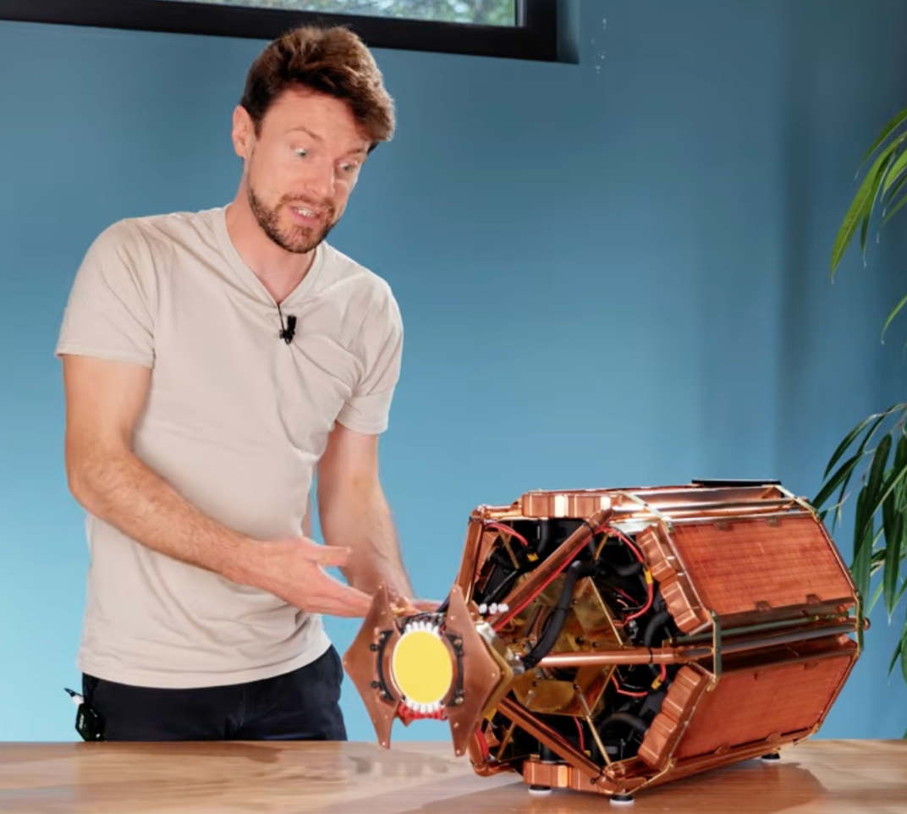
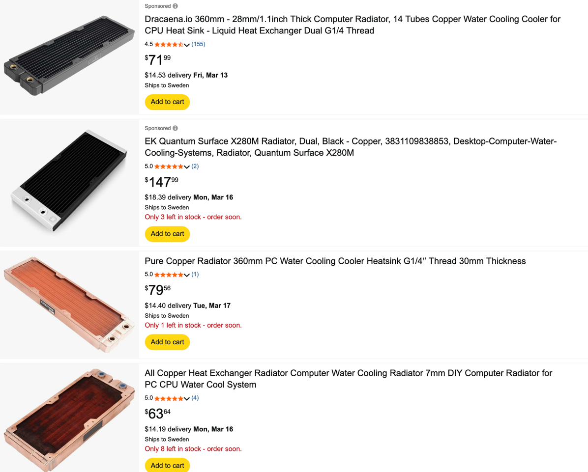

# Todo: Consider to use PC Copper radiators for a passive house air to air heat exchanger?

```#0b78d71c``` *As of 2026-02-28 18:35*

[mail plain/text](mail.txt)


I want my house to use off-the-shelf components for ease of maintenance.

0) Consider some initial ideas and observations for future design

==&gt; Do water cooled PC Copper Radiators provide enough air flow to low noise to work in my house?

==&gt; I imagine a design with 'cross flow' so hot water travels from hot to cold air in the input air channel?

==&gt; So what direction should the water travel in the out air channel?

> *"It seems we should choose a travel direction to maximize the 'cooling' of the air leaving the house. This should mean the cool water from the in air channel should move from cold to hot air? In this way we can hope the water is always colder than the air it meets. And thus it will capture heat from the outgoing air?"*

1) Consider youtube video "Building an LED SUPERNOVA!" to radiate over 1 kW of heat from a LED (https://youtu.be/rqCt61ZbU10 )?

==&gt; Consider the 'heat exchanger' he builds operates on the same wattage as my house needs (1-2 kW)?



2) Consider "PC Copper rtadiator" on amazon?



...


