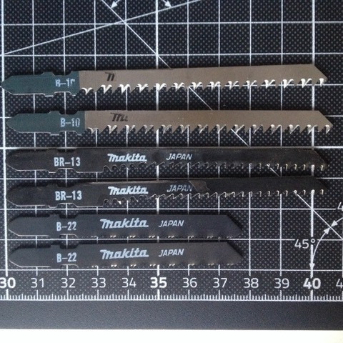
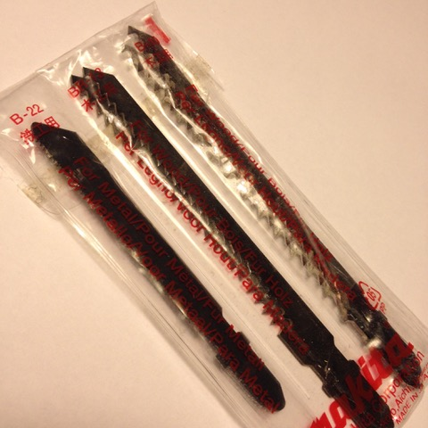
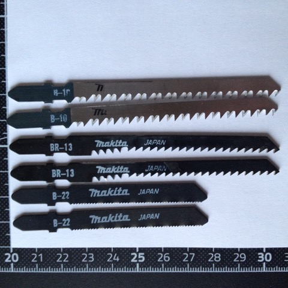
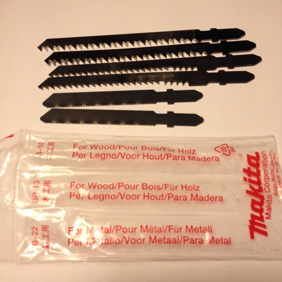

# Todo: Consider to understand jig-saw blades (explicitly for my Makita DJV181Z jig-saw)?

```#0bcd3008``` *As of 2018-12-12 16:26*

[mail plain/text](mail.txt)


It seems it could prove valuable to have at least some understanding about what blades I can get for my Makita DJV181Z jig-saw)?

1) It seems the saw came with s set of blades B-10, BR-13 and B-22?





2) Consider the Makita specs for the jig-saw blades I got with DJV181Z?

==&gt; This seems to be the specs for the B-10 blades (<https://www.makita.com.sg/accproduct/b10-jig-saw-blade>)?

> ## B-10 JIG SAW BLADE

  
> No.Application (mm)Features / Recommended UseWorking Length (mm)Tooth Per InchMaterials of BladeType of CuttingPer pkg.Part No.Wood/ PlywoodPlasticsB-103-653-65For fast finish work. Especially suitable for plywood.758HCSStraight5A-85628


It seems Makita B-10 jig-saw blade is mainly for plywood but can also cut Plastic ( 3 mm &lt; depth &lt; 65 mm)

==&gt; This seems to be the specs for the BR-13 blades (<https://www.makita.com.sg/accproduct/br13-jig-saw-blade>)?

> ## BR-13 JIG SAW BLADE

  
> No.Application (mm)Features / Recommended UseWorking Length (mm)Tooth Per InchMaterials of BladeType of CuttingPer pkg.Part No.Wood/ PlywoodBR-135-65Splinter-free cuts in wood requiring no sanding.649HCSStraight5A-85793


It seems Makita BR-13 is mainly for splinter free cuts in wood but may also cut plywood ( 5 mm &lt; depth &lt; 65 mm)

==&gt; This seems to be the specs for the B-22 blades (<https://www.makita.com.sg/accproduct/b22-jig-saw-blade>)?

> ## B-22 JIG SAW BLADE

  
> No.Application (mm)Features / Recommended UseWorking Length (mm)Tooth Per InchMaterials of BladeType of CuttingPer pkg.Part No.PlasticsAluminumStainless SteelMild SteelB-221-61-31-31-3For mild steel, tough plastic. Especially for thin metal plate.5024HSSStraight5A-85737


It seems Makita B-22 is mainly for metal (mild thin plate metal) but may also cut plastic (1 mm &lt; depth &lt; 3 mm metal / 6 mm Plastic)

3) Consider the range of Makita jig-saw blades (<https://www.makita.com.sg/accessoriescat/jigsaw-blades>)?

==&gt; It seems Makita provides B-types and M-types of blades?


B-type blade


M-type blade

==&gt; It seems Makita provides blades for wood or metall (but that these blades also may cut other materials like plastic, veneers, plywood and particle boards of different types)?

…

…

Consider to update this Todo with information about jig saw blades when appropriate to keep a record of my gathered knowledge in the matter?


