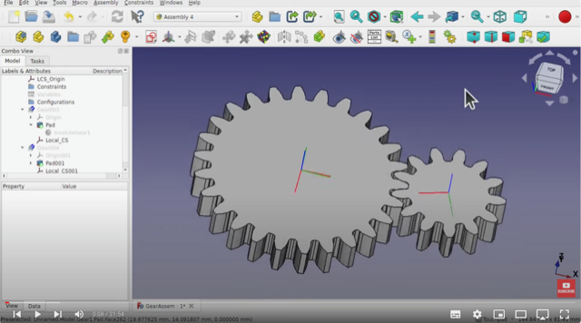

# Todo: Consider youtube channel "MangoJelly Solutions for FreeCAD" on insights into how to use FreeCad?

```#0e2974f9``` *As of 2023-11-22 16:32*

[mail plain/text](mail.txt)


I want easy to follow along videos on how to do stuff and navigate around in FreeCad.

1) Consider youtube channel "MangoJelly Solutions for FreeCAD" (<https://www.youtube.com/@MangoJellySolutions> )?

==&gt; Consider youtube video "FreeCAD For Beginners 33 | Gear Assembly, Animation and Export to Video File" on animation using Assembly 4 workbench (<https://youtu.be/lBtnTuwqhqc?list=LL> )?



<https://youtu.be/lBtnTuwqhqc?list=LL&t=8>

...


