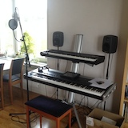

# Todo: Hitta bra "möbler" för hemmastudio

```#0ea05f19``` *As of 2015-11-04 13:06*

[mail plain/text](mail.txt)


Jag verkar ha svårt att få till min hemmastudio.

a) Vilket kbd-stand skall jag använda?  
b) Hur skall jag få plats med både ett Piano och ett keyboard?  
c) Hur ordnar jag snygg förvaring av noter, böcker och musikgrejer?  
d) Hur möblerar jag för lap-top och notställ?  
e) Hur ordnar jag med bra mic-ställ, dämpning och flexibel lösning för att kunna sjunga och spela samtidigt?  
…

&lt;151104&gt;

1) Har just möblerat med Spider stand (<http://produkte.k-m.de/en/Keyboard-stands/Column-stands/18850-Keyboard-stand-Spider-anodized-aluminum>) köpt begagnat från 4-sound kungsholmen (2100 SEK). Men det är lite för vekt och det är fortfarande för mycket sladdar (exponering) och ingen förvaring.  


2) Konkurrenten verkar vara ”APEX® AX-48 PRO” (<http://www.ultimatesupport.com/products/keyboard-stands/apex-series/apex-ax-48-pro-silver.html>) men den ser klenare ut?

3) Skulle egentligen vilja ha en ”compact living” lösning i trä (typ <http://www.montana.dk/en/products/all-products/montana-monterey/> fast med överhylla och skåp för prylar)?

4) Bygga eget med limträskivor (<https://www.k-rauta.se/byggvaruhus/limfogskiva-obeh-furu-18x200x2500-mm>)?

...


