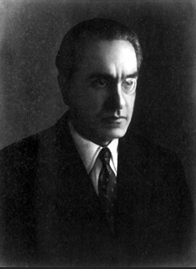
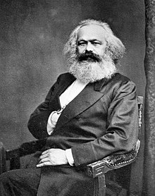

# Todo: Consider how contemporary populism and traditional marxism share the same urge for "meaning" in the form of criticising modernism of robbing our lives of "value"?

```#0ed02146``` *As of 2019-03-12 10:24*

[mail plain/text](mail.txt)


Today when I watched a youtube clip from a nationalistic channel I observed that the way it critiqued modernism is at the bottom of it the "same" critique marxism puts forward?

1) Consider this youtube video "The Spiritual Crisis of the West" (<https://www.youtube.com/watch?v=WNT4gFWboA8>)?

==&gt; Consider what he is talking about is the lack of "Meaning" (valuing diversity means "anything goes" which leads to nihilism as in "there is no one else to be to enhance yourself")?

==&gt; Consider he is citing Julius Evola which is strongly associated with Italian Facism?

==&gt; It seems the reason he cites Julius Evola is the longing for immaterial values (which we can identify as a search for that with deeper "Meaning" than that of material stuff)?

==&gt; Consider how Julius Evolas book titled "Revolt against the modern world" seems to strongly correlate with Marx critique of Kapitalism?

==&gt; Consider how this youtube video seems to argue the importance to "unite" as a nation and a people to not be annihilated?

==&gt; Consider how this relates to Karl Marx argument to "Unite" as workers to not be alienated?

...

2) Consider Marx also identified the lack of "Meaning" in the offered ways of living on modern society (kapitalism)?

==&gt; Consider what Marx is talking about is the lack of "Meaning" (being a cog in production means "anyone goes" which leads to nihilism as in "no matter what you do you are replaceable")?

==&gt; Consider while Marx focused on modern man being robbed of the meaningful work, Julius Evola identified modern human being robbed of meaningful "natural order"?

...

3) Consider the wikipedia article Julius Evola (<https://en.wikipedia.org/wiki/Julius_Evola> )?



*Julius Evola 19 May 1898 – 11 June 1974*

> "Baron Giulio Cesare Andrea Evola (/ɛˈvoʊlə/; Italian: &#91;ˈɛːvola&#93;;&#91;1&#93;19 May 1898 – 11 June 1974), better known as Julius Evola, was an Italian philosopher, painter, and esotericist."

> "He has been described as a "fascist intellectual,"&#91;2&#93; a "radical traditionalist,"&#91;3&#93; "antiegalitarian, antiliberal, antidemocratic, and antipopular,"&#91;4&#93; and as having been "the leading philosopher of Europe's neofascist movement."&#91;4&#93;"

==&gt; Consider how hard it is to read Julius Evola to define Facism as a set of values all of wich are not present also in contemporary progressivism (e.g., new age longing for mystic ways to connect with the transcendental to live "true")?

==&gt; It seems human longing for a truth-behind-reality is one we can't escape but the arguments for it's nature differs (Facism points to well tested (historical) transcendental strength, unity, competence and pride while progressivism points to possible (to be strived for) uncovering of transcendental truth)?

==&gt; Consider how Julius Evola seems to value the immaterial world over the material in his critique of modernity and the ideal of the historical "Golden Age"?

> "Evola's Revolt Against the Modern World is a text that promotes the mythology of an ancient Golden Age. In this work, Evola described the features of his idealized traditional society. Evola argued that modernity represented a serious decline from an ideal society. He argued that in the postulated Golden age, religious and temporal power were united. He wrote that society had not been founded on priestly rule, but by warriors expressing spiritual power. In mythology, he saw evidence of the West's superiority over the East. "

4) Consider the wikipedia article on Karl Marx (<https://en.wikipedia.org/wiki/Karl_Marx> )?



*Karl Marx 5 May 1818 – 14 March 1883*

> "Karl Marx&#91;14&#93; (German: &#91;ˈkaɐ̯l ˈmaɐ̯ks&#93;;&#91;15&#93;&#91;16&#93; 5 May 1818 – 14 March 1883) was a German philosopher, economist, historian, sociologist, political theorist, journalist and socialist revolutionary."

==&gt; Consider Marx searches meaning in a material world through "labour" as opposed to Julius Evola that searches meaning in the immaterial world through "spirituality"?

> "Consequently, Marx revises Hegelian "work" into material "labour" and in the context of human capacity to transform nature the term "labour power".&#91;91&#93;"

5) Consider how this notion of finding the "same" baseline or urge in Marxism as in Fascism relates to Yuval Harari model of "three forms of humanism" (Darwinian, Social and liberal)?

==&gt; It would seem that Yuval Harari observes Fascism, Socialism and Liberalism as three forms of Humanism (but does not try to identify the strive for "Meaning" in these movements)?

==&gt; Consider Yuval Harari tries to identify Fascism, Socialism and Liberalism as three forms of "Human over nature" instead of "Human Values"?

...

...


