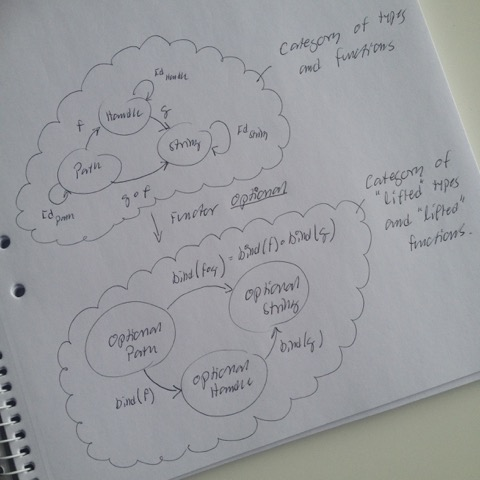
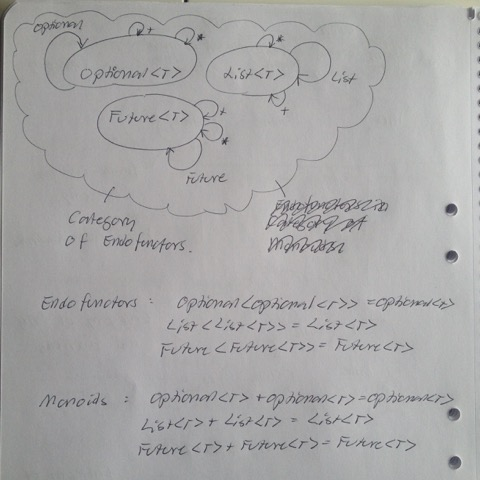

# Todo: Programming - Consider to understand general Category Theory Addition and Multiplication and its correspondence with logical OR and AND and programming data structures Either and Pair?

```#107b6d06``` *As of 2017-02-20 11:55*

[mail plain/text](mail.txt)


It seems we can further understand the implications of Category Theory in programming from the relation between general Category Theory Addition and Multiplication and its realisation in the Category of boolean algebra in the form or OR and AND, and in category of Data Types the Pair and Either?

1) Consider this talk, although painstakingly obscure, as having leads to general Addition and Multiplication (<https://www.youtube.com/watch?v=V10hzjgoklA>)

==&gt; At 9:40 he gives hes own take on Category of Types?


==&gt; It seems the Category(A,B) means the objects A and B together with function f: A —&gt; B?

==&gt; But it seems we need at least three objects (A,B,C) to talk about function composition (We need to be able to talk about two ways to go from A—&gt;C)?

…

==&gt; At 12:50 he introduces Product in Java


**==&gt; It seems Product T1 \* T2 is Pair&lt;T1,T2&gt;?**

==&gt; Q: How is this usable in programming?

==&gt; At 28:20 he introduces Sum


==&gt; Note: For some reason Sum in Category Theory is defined by arrows going in the opposite direction as for definition of Multiplication?

==&gt; It seems this is why the Sum in Java looks so strange?

**==&gt; It seems, and he also says, that Sum T1 + T2 is Variant&lt;T1,T2&gt;?**

==&gt; At 44:50 he compares Sum and Product as being each-others ”reverse”?


2) Consider logical OR and AND are the realisation of Addition and Multiplication in the Category of boolean type?

…

3) Consider the data structures Either (Variant) and Pair (Tuple) as the realisation of Addition and Multiplication in the category of data types?

…

4) Consider Monads as functors that lifts the category iof types and functions to a Category of ”Monadic” (lifted) values and functions?

==&gt; Consider the Monad Optional lifts a Category of types to a Category of Optional types?



==&gt; Optional&lt;T&gt; lifts object T (type) to object Optional&lt;T&gt; (also a type)

==&gt; Optional::bind lifts ”diagonal” functions from T1 to Optional&lt;T2&gt; to the Monoidal function Optional&lt;T1) to Optional &lt;T2&gt;

***==&gt; Hm… It is still a bit awkward where we get the Diagonal Function from (do they occur naturally and the Monad makes the composable)? ***

==&gt; Now it seems the Category of objects being Monads are in fact the same as the Monoids in the Category of Endofunctors?



==&gt; Monads are Endofunctors because if we apply the Monad Functor to its own category we are still in the same category?

Optional&lt;Optional&lt;T&gt;&gt; == Optional&lt;T&gt;

List&lt;List&lt;T&gt;&gt; == List&lt;T&gt;

Future&lt;Future&lt;T&gt;&gt; == Future&lt;T&gt;

…

==&gt; And binary composition of Monadic Values are the new Monadic Values of the same type (the same object)

Optional&lt;T&gt; + Optional&lt;T&gt; == Optional&lt;T&gt;

List&lt;T&gt; + List&lt;T&gt; == List&lt;T&gt;

Future&lt;T&gt; + Future&lt;T&gt; == Future&lt;T&gt;

...

4) Consider we may finally understand the Monad as a Monoid in the category of Endofunctiors?

==&gt; Consider this wikipedia page on the definition of Category (<https://en.wikipedia.org/wiki/Category_(mathematics))?>

==&gt; It seems a Category is an ”Algebraic Structure” of Objects linked by Arrows.

==&gt; It seems, to be a category the arrows must compose and each object must have an identity arrow?


==&gt; It seems Composition of arrows are defined by comparing two paths to get between Objects of the Category.

==&gt; In this case arrow f goes from object A to object B and the g arrow goes from object B to object C. Thus the composition g\*f is defined by the arrow from A to C?

==&gt; Consider this, as one of many, post and thread about a Monad being a Monoid in the Category of Endofunctors (<https://www.quora.com/Is-a-monad-really-a-monoid-in-the-category-of-endofunctors>)?

…

…

Consider to delve deeper into this pattern of OR and AND in boolean Algebra, Either and Pair in Data Types, Addition and Multiplication for integers and so on offers insights to how Category Theory has relevance in programming?

...


