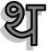
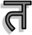
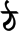
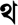

# Todo: Tha - Consider there are actually letters in other languages that has the name "Tha"?

```#10a36d4a``` *As of 2017-06-19 23:51*

[mail plain/text](mail.txt)


On a vim I searched for letters that has the name ”Tha” and found one in MAC (थ) and then I serached the web and found more.

1) Consider the Arabic letter ”Tha” (<http://arabicquick.com/learn-the-arabic-letter-tha/>)?


==&gt; This seems to be the wikipedia page for Tha (<https://en.wikipedia.org/wiki/Ṯāʾ>)

==&gt; It seems to be Unicode U+062B?

==&gt; It seems that ”Tha” is the formel name. Now it is called Theh (<https://www.compart.com/en/unicode/U+062B>)?

ث

**==&gt; Consider to use this symbol to represent a Tha instance in our Meta Vlaue System Tha?**

==&gt; It kind of looks like a composite (container with structured stuff in it)?

==&gt; Consider to use it in Meh Repl to show result?

Meh´&gt; (+ 5 9)

ث 14

Meh´&gt;

==&gt; STRANGE! MAC seems to enforce arabic right-to-left output of digits (writing and deleting to the right causes edits to happen to the left)?

2) Consider the Hindi character Tha (<http://www.learning-hindi.com/post/842512665/lesson-14-consonants-part-4-त-ta-थ-tha-द-da>)?

==&gt; It seems both ”Ta” and ”Tha” could be candidates?

 = Tha

 = Ta

==&gt; It seems to have Unicode U+0925 (<https://m.unicode-table.com/en/0925/>)?

थ

3) Consider Oriya Letter Tha (<https://m.unicode-table.com/en/0B25/>)?

ଥ

==&gt; It seems to be Unicode U+ 0B25?

4) Consider Kannada Letter Tha (<https://www.compart.com/en/unicode/U+0CA5>)

ಥ

==&gt; Hm… Kind of cool (but maybe a bit complicated (and with strange associations)?

4) Consider the Tirhuta letter Tha (<https://en.wikipedia.org/wiki/Tirhuta>)?

 or  (Both named Tha?)

==&gt; It seems it is 𑒟Unicode U+1149 that is Tha (<https://m.unicode-table.com/en/1149F/>)?


==&gt; But MAC seems to fail to render this character if I copy it from the web?

…

Consider to use one of these when wanting to refer to a Tha in documentation?


