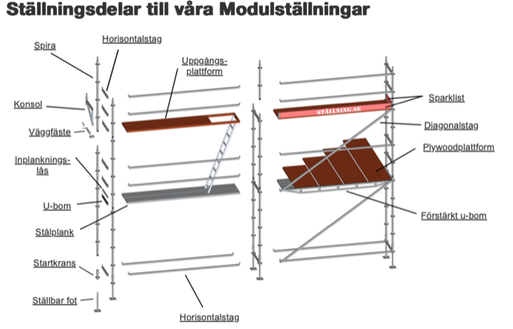
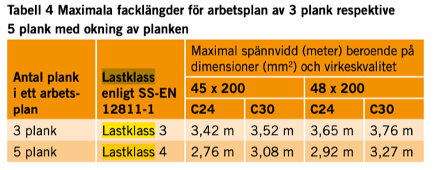
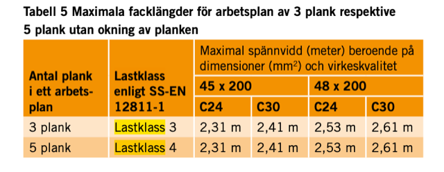

# Todo: Consider scaffolding systems from Swedish ställning.se?

```#1140e8ae``` *As of 2023-11-28 15:53*

[mail plain/text](mail.txt)


I want some modular system of scaffolding to use when building my house.

1) Consider the Swedish vendor [ställning.se](http://xn--stllning-1za.se) (<https://www.stallning.se/byggstallning/modulstallning/stallningsdelar> )?



2) Consider Swedish codes for building platforms and scaffolding according to arbetsmiljöverket (<https://www.av.se/globalassets/filer/publikationer/bocker/sakra-stallningar-bok-h456.pdf> )?





3) It seems Swedish code for building scaffolding is based on SIS standard "Temporära konstruktioner - Del 1: Ställningar - Krav och utförande" (<https://www.sis.se/produkter/byggnadsmaterial-och-byggnader/konstruktionsteknik/ssen12811120042/> )?

4) Consider indications of load class implications by [ställningar.se](http://xn--stllningar-r5a.se) (<https://www.stallning.se/byggstallning/ramstallning-/stallningsdelar-ram/aluminium-plywood-plus> )?

> **Lastklass 1-3 har följande lastvillkor:**
- Lastklass 1: Utbredd last av 0,75 kN/m²
- Lastklass 2: Utbredd last av 1,50 kN/m²
- Lastklass 3: Utbredd last av 2,00 kN/m²

> Lastklass 1–3 ska även kunna uppta dels en koncentrerad last av 1,50 kN på en yta av 500 x 500 mm, dels en koncentrerad last av 1,00 kN på en yta av 200 x 200 mm.

> **Lastklass 4-6 har följande lastvillkor:  
> **
- Lastklass 4: Utbredd last av 3,00 kN/m²
- Lastklass 5: Utbredd last av 4,50 kN/m²
- Lastklass 6: Utbredd last av 6,00 kN/m²

> Lastklass 4–6 ska även kunna uppta dels en koncentrerad last av 3,00 kN på en yta av 500 x 500 mm, dels en koncentrerad last av 1,00 kN på en yta av 200 x 200 mm.

> **Lastklass 4–6 ska även kunna uppta en delarealast enligt följande:  
> **
- Lastklass 4: Delarealast av 5,00 kN/m2 på 40 % av ytan
- Lastklass 5: Delarealast av 7,50 kN/m2 på 40 % av ytan
- Lastklass 6: Delarealast av 10,00 kN/m2 på 50 % av ytan


==&gt; It seems these clarifications indicates limitations on the use a pallet jack to move semi-heavy loads across a floor with these load classifications?

> *An allowed concentrated load of 1000 N (100kg) on 200x200 mm means each wheel of the pallet jacket can only carry 100 kg, meaning the total weight of the pallet jack of 300 kg is the limit of what the flooring will tolerate?*

...


