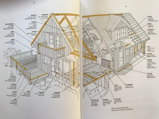
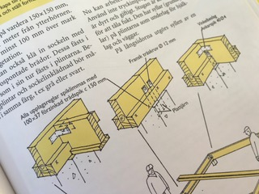

# Todo: House Build - Consider how much "house" I can plan in 1:30 hours?

```#11c13358``` *As of 2019-07-14 18:23*

[mail plain/text](mail.txt)


So it seems I have to play games with myself to force myself to do work to get my new house actually built!

==&gt; Also see "[Todo: Bygga Hus - Överväg att rita och göra en kostnadskalkyl på ett "standard" träregel-hus utan "mankemang" (enligt boken Praktisk Husbyggnadsteknik)?](../52cb86ee/chime.md)"

==&gt; Also see "[Todo: Överväg att börja skissa på en plan till mitt nya boende (mitt egenbyggda hus)?](../a82a91a0/chime.md)"

==&gt; Se också “[Todo: Överväg att spekulera i mina drömmar om ett meningsfullt boende?](../a3be6b98/chime.md)”

==&gt; Se också “[Todo: Eget Hus - Överväg tre "Drömhus" (På häll i skog, på klippa över "hav" och Vid sjö)?](../ea75d78f/chime.md)”

==&gt; Se också “[Todo: Eget Hus - Överväg att ha flera separata vattensystem för olika behov i huset för att effektivisera (minimera) vatten och energiförbrukning?](../0736f74e/chime.md)”

==&gt; Se också “[Todo: Bygga eget hus - Anteckna det jag hittat på nätet som kan hjälpa mig bygga ett trähus?](../4a994944/chime.md)”

==&gt; Se också “[Todo: Bygga eget hus - Försök förstå det där med fastighetsavgift och fastighetsskatt?](../abb95fb7/chime.md)”

==&gt; Se också “[Todo: Gå en knuttimringskurs (timra eget hus?) :)](../c50294d0/chime.md)”

==&gt; Se också “[Todo: Bygga Hus - Överväg att rita och göra en kostnadskalkyl på ett "standard" träregel-hus utan "mankemang" (enligt boken Praktisk Husbyggnadsteknik)?](../52cb86ee/chime.md)”

==&gt; Se också “[Todo: Överväg att hitta tomt och bygga (fritids)hus?](../6e670197/chime.md)”

==&gt; Se också “[Todo: Bygga hus - Överväg att hitta bra 3D-program för att rita hus "på plats”](../54573c16/chime.md)"

==&gt; Se också “[Todo: Bygga Hus - Överväg att rita ett hus som är en direkt kopia på min nuvarande lägenhet?](../4c402865/chime.md)”

==&gt; Se också “[Todo: Överväg att bygga ett hus i en lagerlokal som jag sedan kan placera på en tomt någonstans?](../a81f122b/chime.md)”

==&gt; Se också “[Todo: Bygga hus - Kolla upp nyckelfärdiga hus på tillhandahållen eller egen tomt?](../4a11c2aa/chime.md)”

1) 0:00 - Consider a property to build on?

At 00:17 Consider this property outside Hjo (<https://www.hemnet.se/bostad/tomt-langeruder-hjo-vastergotland-hjo-kommun-tjadervagen-9,-544-92-hjo-396636> )?

69 000 SEK


2) At 20:00 Consider a BOM for a house to build on the property?

==&gt; Consider the wooden frame construction from "Praktisk Husbyggnadsteknik" by Keneth Sandin?



==&gt; Consider a floor foundation?

==&gt; At 00:33 I had printed the floor foundation from Fusin 360 (logged in and taken a screen capture to print from Apple Preview)

==&gt; At 00:36 I realised that I had not made the 360 model of my apartment with correct dimensions!

==&gt; At 00:42 I realised I HAD added correct dimensions (in mm and was unable to change to meters to get a readable dimension into the drawing)

Q: How do I design a house foundation on pillars that can hold the house (I have yet to find a design to be able to estimate a cost)?

==&gt; At 00:50 I found in "Bygga Fritidsstuga" by lars Ingemar Hultqvist page 26 to place floor foundation beams 60 cm apart (seems like some form of standard)?

==&gt; At 1:00 I realised the design in "Praktisk Husbyggnadsteknik" by Keneth Sandin does NOT include foundation beams to allow for pillar resting floor foundation (wall frames rest on concrete sole or something)?



*Floor Foundation on pillars*

==&gt; It seems I can buy building materials from "Hjo Byggnadsmaterial & Glas AB" (<http://www.hbmg.se/bradgarden/> )?

==&gt; At 1:07 I assumed prices in around the ones from Bauhaus and Hornbach in Stockholm?

==&gt; I decided to NOT use wood impregnated against fungus (more expensive and I want a design that keeps the wood dry in the first place)?

==&gt; At 1.12 I realised that Bauhaus does NOT sell 70 x 220 wood (suggested for base "syll" for the floor foundation)

==&gt; The thiskest wood available is 45 mm (I need double size and do NOT want to join two as water will get in between them)?

Q: Where do I get 70 x 220 wood and what does it cost?

==&gt; It seems from woody I get a price indication of (<https://pog.woody.se/hus-bygg/traprodukter/konstruktionsvirke/w0100-70x220-k-virke-c24-fingerskarvad-gran> )?


*Example price (Woody web shop) for C24 class 70 x 220 fir around 115 SEK / m*

Q: What is construction class C24 (woody seems to suggest class in range C14..C35 is approved for construction beams)?

Q: How do I design the foundation beams to allow them to be built from 6 m or 7.8 m lengths?

> *The book "Bygga Fritidsstuga" by lars Ingemar Hultqvist specifies to extend the beams over pillars. But I wnat to reduce the pillars so I want foundation beams that can rest on pillars at the corners or somewhere at selected centres of gravity so I need another solution.*

Q: How do I transport wood of up to 7.8 m lengths?

==&gt; At 1:23 I deduce I need 2x8 + 2x11 meters of 70x220 = 4370 SEK (inc. VAT)

==&gt; At 1:38 I deduced I need 22m 45x70 for inside rest for floor beams = 500 SEK


==&gt; At 1:46 I deduced I need 6 pillars times two "plattjärn" = 12 x 45 = 540 SEK


==&gt; I deduced I need 18 or 19 floor pillars (60 cm apart over 11 m) of dimension 45 x 195

==&gt; I deduced I need 13 or 14 of 8 m length and 5 of 6m length &lt;= 174m = 7830 SEK

Q: How do I design floor pillars of 8m length that can sufficiently hold the strain required for a rigid floor (


==&gt; -------------------------------------------------------------------------------------------------------------------------------------------

==&gt; At 2:00 I deduced the wood for the floor foundation costs around 13 240 &lt;= 15 000 SEK (inc VAT)

WE ARE HERE - TODO: Continue with the inner flooring and the wall framing

...

2) Consider observations I make during my "force build" of a house?

==&gt; Hemnet does NOT allow adjustment of "from" location to make Google Maps find a route to say Stockholm (You can only change the "To" location)

==&gt; Bauhaus does NOT sell 70 x 220 dimensional wood (it seems)?

==&gt; I need a way to transport wood of 6m and or up to 7.8 m length (as these length are available to buy)


