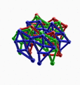
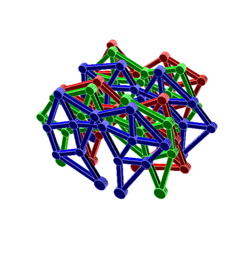

# Todo: Consider to investigate and optionally try out the Open SCAD software for script-based 3D modelling of mechanical designs?

```#124e9802``` *As of 2019-01-05 18:49*

[mail plain/text](mail.txt)


It seems it could be informative and interesting to study the Open SCAD application and source code to see if I can use it for something and possibly build on it to make my own Tha-CAD software?

1) It seems the Open SCAD project lives here (<http://www.openscad.org>)?

==&gt; It seems the current download for OS X is this link (<http://files.openscad.org/OpenSCAD-2015.03-3.dmg> )?


==&gt; The rendering seems to be based on parsing a script language?


==&gt; The OpenScad seems to live here (<https://en.wikibooks.org/wiki/OpenSCAD_User_Manual>)?

2) Consider the Strandbeest design example in OpenScad manual (<https://en.wikibooks.org/wiki/OpenSCAD_User_Manual/Example/Strandbeest>)?


==&gt; This seems to be the code to animate (yes it seems to be an animation) of the strandbeest design?

> ## Source&#91;[edit](https://en.wikibooks.org/w/index.php?title=OpenSCAD_User_Manual/Example/Strandbeest&action=edit&section=9)&#93;

  
> ```
> //------------------------
> // Trigonometry Functions
> //------------------------
> function add2D(v1=[0,0],v2=[0,0]) =
>     [
>         v1[0]+v2[0],
>         v1[1]+v2[1]
>     ];
>
> function sub2D(v1=[0,0],v2=[0,0]) =
>     [
>         v1[0]-v2[0],
>         v1[1]-v2[1]
>     ];

> function addAngle2D(v1=[0,0],ang=0,l=0) =
>     [
>         v1[0]+cos(ang)*l,
>         v1[1]-sin(ang)*l
>     ];

> function getAngle2D(v1,v2=[0,0]) =
>   atan2(
>     (v2[0]-v1[0]), //dx
>     (v2[1]-v1[1])  //dy
>   );

> function scale2D(v1=[0,0],c=1)=
>   [
>     v1[0]*c,
>     v1[1]*c,
>   ];

> function length2D(v1,v2=[0,0])=
>   sqrt(
>       (v1[0]-v2[0])*(v1[0]-v2[0])
>       +
>       (v1[1]-v2[1])*(v1[1]-v2[1])
>     );

> //Law of cosines
> function VVLL2D(v1,v2,l1,l2) =
>   let(sAB = length2D(v1,v2))
>   let(ang12=getAngle2D(v2,v1))
>   let(ang0=
>         acos(
>           (l2*l2-l1*l1-sAB*sAB)/
>           (-abs(2*sAB*l1))
>         ))
>
>   addAngle2D(
>     v1=v1,
>     ang=ang0+ang12-90,
>     l=-l1
>   );

> //----------------------
> // modules (Graphic Functions)
> //----------------------
> // draw "rod" from v1 to v2 with thickness t
> module rod(v1=[0,0],v2=[0,0],t=6){
> 		ang1=getAngle2D(v1,v2);
>     len1=length2D(v1,v2);
> 		translate([v1[0],v1[1]])
> 		rotate([0,0,-ang1]){
> 			translate([0,0,0]){
> 					cylinder(r=t,h=t+2,center = true);
> 			}
> 			translate([-t/2,0,-t/2]){
> 				cube([t,len1,t]);
> 			}
> 		}
> }

> //----------------------
> // Leg Module // Jansen mechanism
> //----------------------
> module leg (
>     ang=0,
>     a=38.0, //a..m Theo Jansens Constants
>     b=41.5,
>     c=39.3,
>     d=40.1,
>     e=55.8,
>     f=39.4,
>     g=36.7,
>     h=65.7,
>     i=49.0,
>     j=50.0,
>     k=61.9,
>     l= 7.8,
>     m=15.0
>     )
> {
>   Z = [0,0]; //Origin
>   X = addAngle2D(Z,ang,m); //Crank
>   Y = add2D(Z,[a,l]);
>   W = VVLL2D(X,Y,j,b);
>   V = VVLL2D(W,Y,e,d);
>   U = VVLL2D(Y,X,c,k);
>   T = VVLL2D(V,U,f,g);
>   S = VVLL2D(T,U,h,i); //Foot
>
>   rod(Z, X);
>   rod(X, W);

>   rod(W, Y);
>   rod(W, V);
>   rod(Y, V);
>   rod(X, U);
>   rod(Y, U);
>   rod(U, T);
>   rod(V, T);
>   rod(U, S);
>   rod(T, S);
>   rod(Z, Y);

>   //draw the foot point
>   translate(S){
>     cylinder(r=8,h=8,center = true);
>   }
> }

> //----------------------
> // Strandbeest
> //----------------------
> module Strandbeest(ang=$t*360,o=360/3,sgap=20,mgap=50)
> {
>     {
>         color([1, 0, 0]) translate([0,0,sgap*0]) leg(ang+o*0);
>         color([0, 1, 0]) translate([0,0,sgap*1]) leg(ang+o*1);
>         color([0, 0, 1]) translate([0,0,sgap*2]) leg(ang+o*2);
>     }
>     mirror(v= [1, 0, 0] ){
>         color([1, 0, 0]) translate([0,0,sgap*0]) leg(180-ang-o*0);
>         color([0, 1, 0]) translate([0,0,sgap*1]) leg(180-ang-o*1);
>         color([0, 0, 1]) translate([0,0,sgap*2]) leg(180-ang-o*2);
>     }
>     translate([0,0,sgap*2 + mgap])
>     {
>         color([1, 0, 0]) translate([0,0,sgap*0]) leg(180+ang+o*0);
>         color([0, 1, 0]) translate([0,0,sgap*1]) leg(180+ang+o*1);
>         color([0, 0, 1]) translate([0,0,sgap*2]) leg(180+ang+o*2);
>     }
>     translate([0,0,sgap*2 + mgap])
>     mirror(v= [1, 0, 0] ){
>         color([1, 0, 0]) translate([0,0,sgap*0]) leg(0-ang-o*0);
>         color([0, 1, 0]) translate([0,0,sgap*1]) leg(0-ang-o*1);
>         color([0, 0, 1]) translate([0,0,sgap*2]) leg(0-ang-o*2);
>     }
> }

> //leg(ang=$t*360);

> rotate([90,180,0]) Strandbeest();

> ```


==&gt; And this seems to be the animated GIF created by OpenScad using the export function ([File:Strandbeest_3d_-_crank_offset_corrected.gif](https://commons.wikimedia.org/wiki/File:Strandbeest_3d_-_crank_offset_corrected.gif))

 

3) It seems the Open SCAD source and build project lives here on GitHub (<https://github.com/openscad/openscad/>)?

==&gt; It seems the dependencies on external libraries and tools are extensive?!

- A C++ compiler supporting C++11
- [Qt (4.4 -&gt; 5.x)](https://qt.io/)
- [QScintilla2 (2.7 -&gt;)](https://riverbankcomputing.co.uk/software/qscintilla/)
- [CGAL (3.6 -&gt;)](https://www.cgal.org/)
- [GMP (5.x)](https://gmplib.org/)
- [MPFR (3.x)](https://www.mpfr.org/)
- [cmake (2.8 -&gt;, required by CGAL and the test framework)](https://cmake.org/)
- [boost (1.35 -&gt;)](https://www.boost.org/)
- [OpenCSG (1.3.2 -&gt;)](http://www.opencsg.org/)
- [GLEW (1.5.4 -&gt;)](http://glew.sourceforge.net/)
- [Eigen (3.x)](http://eigen.tuxfamily.org/)
- [glib2 (2.x)](https://developer.gnome.org/glib/)
- [fontconfig (2.10 -&gt; )](http://fontconfig.org/)
- [freetype2 (2.4 -&gt; )](https://freetype.org/)
- [harfbuzz (0.9.19 -&gt; )](http://harfbuzz.org/)
- [libzip (0.10.1 -&gt; )](https://libzip.org/)
- [Bison (2.4 -&gt; )](https://www.gnu.org/software/bison/)
- [Flex (2.5.35 -&gt; )](http://flex.sourceforge.net/)
- [pkg-config (0.26 -&gt; )](https://www.freedesktop.org/wiki/Software/pkg-config/)

  
==&gt;


