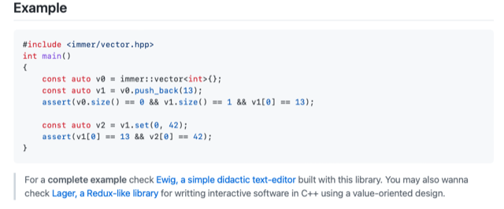

# Todo: Darwinet - Consider to implement the Typescript CRTD-library "Collab" in C++ based on C++ immutable library "Immer"?

```#12aef88f``` *As of 2022-05-16 16:43*

[mail plain/text](mail.txt)


==&gt; Also see "[Todo: Darwinet - Consider to delve into the Typescript CRTD library "Collabs" to follow up on the latest research and state of "shared state" technologies and knowledge?](../aaf15dcd/chime.md)"

==&gt; Also see "[Todo: Programming - Consider to check out the C++ Immutable Data Structures Library "Immer" and possibly if to use it with Darwinet implementation?](../eae8d897/chime.md)"

1) It seems Collabs lives on Github here (<https://github.com/composablesys/collabs> )?

==&gt; It seems, to use it, you clone their github repository?

> ```
> git clone https://github.com/composablesys/collabs.git<https://github.com/composablesys/collabs.git>
> cd collabs/collabs
> npm i
> npm run build

> ```

> Open `docs/typedoc/index.html` in a browser.

2) Consider to try and base the implementation on the C++ immutable data types library "Immer"?

==&gt; It seems "Immer" is still alive and well with resent activity onGithub (<https://github.com/arximboldi/immer> )?

> 

...


