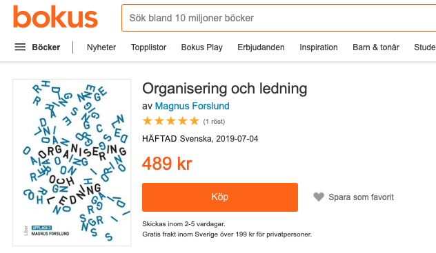

# Todo: Synteocracy - Consider to map the book "Organisering och ledning" by  Magnus Forslund to my idea of synteocracies as a model of how humans act collectively?

```#13d95fbd``` *As of 2022-07-30 12:09*

[mail plain/text](mail.txt)


1) The book seem to sell on Bokus for 500 SEK (<https://www.bokus.com/bok/9789147128617/organisering-och-ledning/> )?



2) Consider how I may map my idea of how Synteocracies is a model of how we act collectively on our highest level of understanding?

> *So, the basic idea here, is that I can use a book like **"Organisering och ledning" by Magnus Forslund to get a grip of contemporary models of how to organise and lead large groups of people and then map this to my own idea of humans acting collectively as guided by synteocracies?*

...


