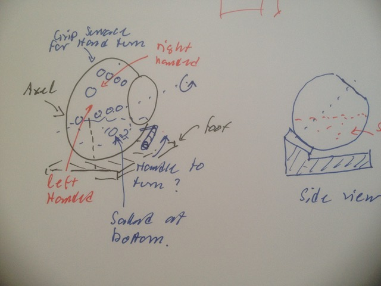

# Todo: Consider to make a tilted Sallat Tumbler (model after a concrete mixer)?

```#1468fc21``` *As of 2018-05-11 16:23*

[mail plain/text](mail.txt)


It seems to be able to tumble sallads in dressin one could imagine having the sallat in a tilted bowl that can rotate and thus topple over the sallat and the dressin concrete-mixer-style?

1) Consider a sallat tumbler design?



2) Compare with the design of concrete mixers?


3) Consider what we can buy to use as components to build the sallat tumbler bowl?

NOTE: Google on “Sallat Tumbler” yields no results (interesting)?

==&gt; Consider to find someone that can turn pottery bowls with the correct shape?

...

...


