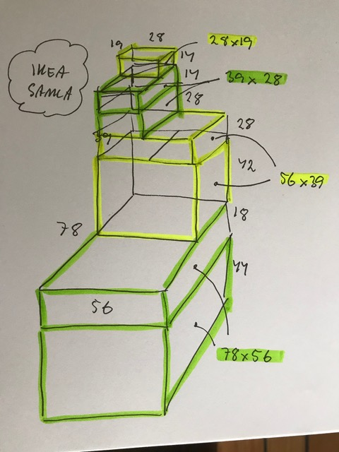
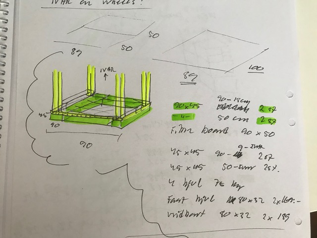
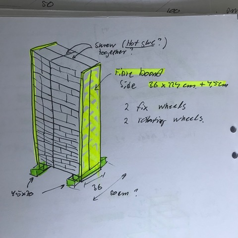

# Todo: Home Storage - Consider a BOM for different flexible home storage solutions on wheels (optionally on walls)?

```#157c1410``` *As of 2019-06-19 20:49*

[mail plain/text](mail.txt)


Maybe I must accept that the fastest way to get my home storage solution is to actually just buy it?

1) Consider possible components to use for my movable and flexible home storage system on wheels?

==&gt; Consider IKEA SAMLA (189 SEK, 119 SEK, 99 SEK, 69 SEK, 35 SEK, 29 SEK, 15 SEK)



*IKEA SAMLA transparent boxes with lid 78x56x(44 or 18), 56x39 x (42 or 28), 39x28 x (28 or 14) and 28x19x14*

> *It seems the height 14 cm can be stacked to 2x14 = 28, 3x14 = 42. But the largest boxes with height 18, 42 and 44 cm does not "stack" to anything so they are meant to be at the bottom. *


*IKEA ALGOT wire frame with drawers 41 x 60 x 100*


*IKEA ALEX drawers 36x58 height 70 cm or 116 cm*


*IKEA KNAGGLIG wooden box 46 x 31 x 25 cm*


*IKEA KVISSLE Letter box in steel Bredd: 32 cm Djup: 25 cm Höjd: 32 cm*


*IKEA KNAGGLIG 23 x 31 x 15 cm*

2) Consider an "IKEA IVAR" on wheels?

==&gt; Consider a bottom frame 90 x 50 from timber frame and fibre board?




 

3) Consider IKEA MOPPE "Wall"



*28 IKEA MOPPE mini drawers (168 individual compartments) wood glued to fibre board sides and bottom wood frame with wheels*

> *If we glue together (wood glue) 28 IKEA MOPPE mini drawers we get in total 168 individual compartments. Each drawer will be of size 15x17, 13x17, 20x17 or 40x17 all 10 cm high.*


*IKEA MOPPE "mini drawer" 18 cm deep, 32 cm high and 31 or 42 cm wide *

*==&gt; Consider with IKEA MOPPE we can cover 2x31 (62 cm), 31 + 42 (73 cm) or 2x42 = 84 cm wide "wall".*

> *If we go for a 31 + 42 = 73 cm wide "wall" it will fit also where my 80 wide Billy shelves does not? Seven of them on the height will reach 224 cm requires 14 (7x179 + 7\*199) = 1253 + 1393 = **2449 SEK**. And we get 7 x (6+6) = **84 small drawers**! If we **double** this to create a back-to-back rack it will be 73 x 36 at the base, 224 cm high and carry **168 small drawers**!*

...


