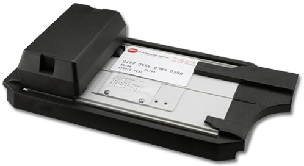
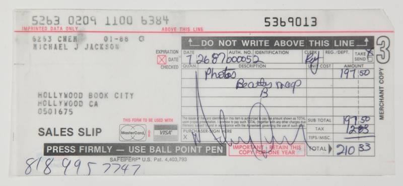

# Todo: Blogpost - Consider to explain card payments "behind the scenes"?

```#159456d6``` *As of 2016-06-15 13:23*

[mail plain/text](mail.txt)


So, am I ready to explain a card payment to system designers and stake holders of card payment system processing systems?

&lt;??&gt;

When the customer leaves the merchant store having paid with a card he or she owes their bank the amount of the purchase. And the cardholders bank simultaneously owes the merchant the same amount.

Cardholder ==&gt; Owes ==&gt; Cardholder Bank ==&gt; Owes ==&gt; Merchant

When the Merchant has presented the IOYs to its Acquirer (The Merchants Bank) the Issuer owes the Merchant bank the amount and the amount minus fees has been transferred to the Merchant account.

Cardholder Bank ==&gt; Owes ==&gt; Merchant Bank ==&gt; (amount - fees) ==&gt; Merchant Account

When the Merchant Bank has cleared all the IOYs with an Issuing Bank the net debt owed by the Issuer to the Acquirer has been agreed upon.

Card Issuer Bank ==&gt; Owes ==&gt; Acquiring Bank

When the net debt between Issuing Bank and Acquiring Bank is settled the Amount minus fees are transferred from each Issuing Bank to each Acquiring Bank.

Card Issuer Bank ==&gt; (amount - fees) ==&gt; Acquiring Bank

&lt;??&gt;

A cardholder brings a card to a merchant point of sale to pay for a purchase.

In early days of card payments the Merchant could accept the card as payment by using it to create an IOY (I Owe You) signed by the cardholder. The IOY was created using a Credit Card Imprinter.



The resulting IOY is represented by the imprinted Credit Card Sales Slip.



In theory one would expect the Merchant to go to the Bank that issued the card to collect the money of the IOY. Instead the Merchant has an agreement with an Acquirer Bank. The merchant brings all Credit Card Sales Slips and presents them to the Acquirer and in return the amount of all IOYs are transferred to the Merchant Account.

The role of the Acquirer is to serve as a one-point presentment location of Credit Card IOYs. Thus, the Merchant does is not required to seek out each and everyone of the Issuing Banks of the Credit card Slips. The Acquirer performs this service in return from receiving all the slips.

Now, behind the scenes the Acquirer clears all received Cedric Card Sales Slips with all Card Issuers involved. The result of this clearing process is to verify that each slip is accepted by each Issuer and to reach a net IOY from each issuer to each Acquirer. Possible fraudulent slips are questioned and processed. If an acquired slip is found invalid the Merchant may face a chargeback. But often, if the Merchant has complied to the security measures required the Acquirer steps in and assumes the loss.

Once the net debts between Issuers and Acquirers has been reached they are all setled one by one. Thus Each Issuer transfers funds to each Issuer as defined by the Clearing results.

Thus we may conclude that a card Payment includes a set of common processing steps.

- The cardholder presents a card to the merchant to fund a purchase.
- The Merchant acquires an IOY accountable by the Card Issuer on behalf of the Card Holder.
- The Merchant presents the IOY to the Acquirer in return for funds being transferred to the Merchant Bank Account.
- The Acquirer clears all the IOYs with each Issuer Issuer resulting in single IOYs from each Issuer.
- Each IOY is then settled with each Issuer.

…

Consider to elaborate on this way of explaining Card Payments in a clear and understandable way (using the IOY idiom)?

...


