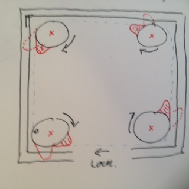

# Todo: Consider a Frame Locking Mechanism based on corner rotating (3D printed) tongues extending into surrounding frame on rotation?

```#172a6a28``` *As of 2018-11-28 12:42*

[mail plain/text](mail.txt)


It seems we can enhance the attachment method of my tool wall frames by creating a set of rotating disks with asymmetry that widens into surrounding frame when rotated?

1) Consider a design of corner located rotating tongues that expands into surrounding frame on rotation?

==&gt; It seems we should be able to 3D print disks that rotates and have a tongue that then protrudes into the surrounding frame?



2) Consider attachment for my indoor shed where I can try out this “rotating tongue” locking mechanism?

==&gt; Consider to build a “rotating tongue” locking mechanism for a tool wall to attach to the framing of my indoor shed?

==&gt; Consider to build a “rotating tongue” locking mechanism for a wall screw storage (bolts, nuts and wood screws) for my indoor shed?

...

…

Consider to elaborate and optionally build a proof of concept to attach tool walls or other accessories into the framing of my indoor shed?

...


