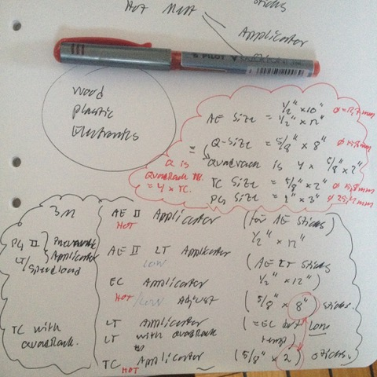

# Todo: Hot Melt Adhesive System - Consider to compare 3M or TechSil Hot Glue Gun Systems (Hot and Low melt)?

```#1793b731``` *As of 2018-12-04 21:32*

[mail plain/text](mail.txt)


It seems I can safely narrow down my selection of Hot Meld Adhesive system (Hot Glue Gun and sticks) to the ones provided by 3M and UK based TechSil?

==&gt; Also see “[Todo: Consider to learn about hot glue and glue guns (to decide on what first glue gun and glue to purchase)?](../61f5d812/chime.md)”

-2) 181204 - Ordered 3M Hot Melt Applicator LT and TC plus glue sticks

ELFA TC-Q EUR 220 - Glue Gun - 3M  1628 SEK

ELFA 3M 3792 Q 5 st 68 SEK

eBay UK “3M Scotch-Weld Hot Melt Applicator LT Quadrack 240V” £155

Amazon US


==&gt; Ok - not cheap - but I wanted a good quality hot glue gun system...

-1) Consider options for how and where to buy the glue gun and sticks I selected?

==&gt; Consider to buy 3M Glue Gun(s)

"3M Hot Melt Applicator LT"

"3M Hot Melt Applicator TC"

"3M Hot Melt Applicator EC"

==&gt; Consider ELFA 1630 SEK 3M Hot Melt Applicator TC ([https://www.elfa.se/en/glue-gun-3m-tc-eur-220v/p/18092702?q=\*&filter_Category3=Adhesive+Guns&filter_Buyable=1&page=16&origPos=16&origPageSize=25&simi=99.9](https://www.elfa.se/en/glue-gun-3m-tc-eur-220v/p/18092702?q=*&filter_Category3=Adhesive+Guns&filter_Buyable=1&page=16&origPos=16&origPageSize=25&simi=99.9))?


1) It seems I would like to have at least one Low Melt and one Hot Melt glue gun that can take a system of glue sticks for Wood, plastic and electronics?

3M Hot Meld Adhesive System

Low Meld

Hot Meld

TechSil Hot Meld Adhesive System

Low meld

Hot Meld

2) Consider to understand the 3M Hot Meld Adhesive system (<http://multimedia.3m.com/mws/media/44021O/3m-hot-melt-bonding-systems-guide.pdf>)?



==&gt; It seems I have finally figured out what the 3M hot meld glue stick size dedications stands for?

TC = 5/8” x 2”

Q = 4 x length of TX = 5/8” x 8”

AE = 1/2” (10” or 12” length)

PG = 1” x 3” (i.e., short bulky stubs of glue)

==&gt; It seems the post-fix “LT” is used to indicate “Low Temperture” (for applicators) and “LM” for “Low Meld” (for glue sticks)?

==&gt; So what I want is the 3M Hot Melt Applicator (one low, LT, and one Hot, TC)

 

==&gt; And I can go with the “QuadRack” sticks adaptor

==&gt; I can also go for two temperature controlled 3M Hot Melt Applicator EC


==&gt; It seems the search term to find the 3M glue guns are “ 3M Hot Melt Applicator LT/TC/EC”

"3M Hot Melt Applicator LT"

"3M Hot Melt Applicator TC"

"3M Hot Melt Applicator EC"

3) Consider to understand the UK based TechSil Hot Meld Adhesive System (


