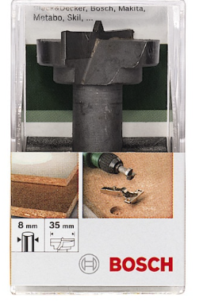
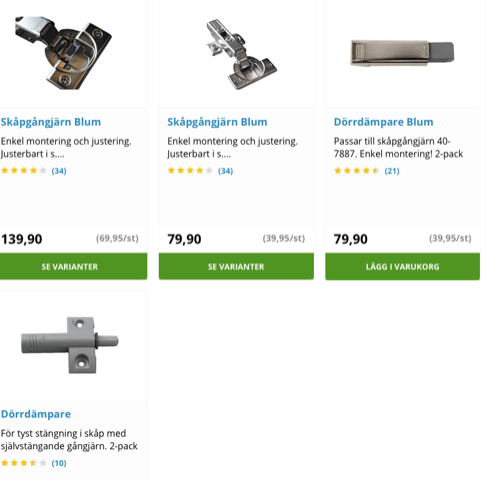
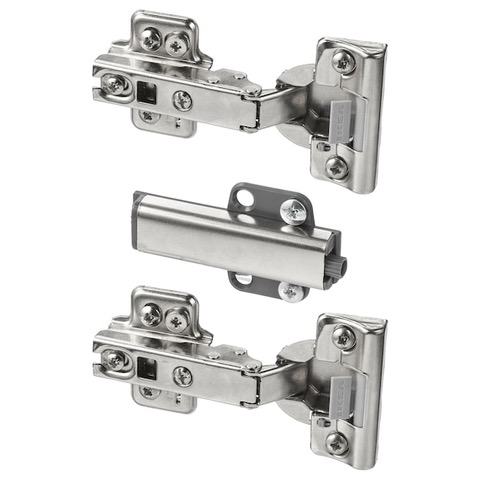
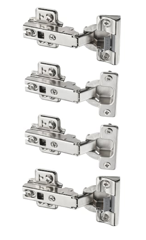
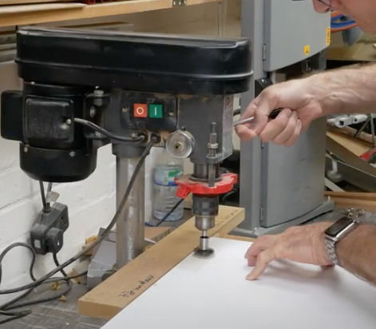
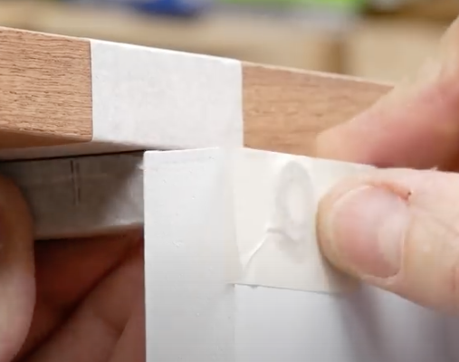

# Todo: Consider to understand European concealed hinges - how to mount and where to buy?

```#17a052c1``` *As of 2021-07-26 01:10*

[mail plain/text](mail.txt)


1) Consider this YouTube video "All the main Blum hinge types explained!" (<https://youtu.be/0azawdMU6L4> )?

...

2) It seems I need a 35 mm forstner bit to counter sink the hinge body?



<https://www.clasohlson.com/se/Centrumborr-HM-Bosch/p/40-9222>

3) It seems I can buy a limited collection from Swedish Clas Ohlson (<https://www.clasohlson.com/se/c/Brand/BLUM> )?



4) It seems IKEA PAX system uses European concealed hinges?

==&gt; Consider this IKEA press-to-open concealed hinges set (<https://www.ikea.com/se/sv/p/besta-gangjaern-mjukstaengande-tryck-oeppna-80261258/> )?



==&gt; Consider IKEA soft close concealed hinges (<https://www.ikea.com/se/sv/p/komplement-mjukstaengande-gangjaern-30214504/> )?



5) Consider Peter Millard "Concealed Hinges Behind The Scenes (Patreon #8)" (<https://youtu.be/sKxiiKNkkLk> )?

==&gt; He seems to prefer to drill the 35 mm holes on the drill press (<https://youtu.be/sKxiiKNkkLk?t=115> )?



6) Consider Peter Millard youtube video "How I fit: Touch Latches &#91;video #380&#93;" (<https://youtu.be/6yCdFClXUOU?t=139> )?

==&gt; He seems to tape the washer to the front to ensure he fits the latch at the correct depth (<https://youtu.be/6yCdFClXUOU?t=242> )?



...


