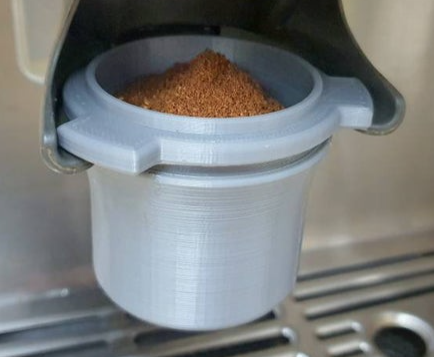

# Todo: Consider to 3D Print a dosing mugg för my ROK 49...51 mm portafilter (so I can shake 16-18 g of coffee "in place")?

```#1828c6b9``` *As of 2021-06-18 18:13*

[mail plain/text](mail.txt)


==&gt; Also see "Todo: Consider to buy a 47,7 mm diameter coffee tamper for my ROK manual coffee machine porta filter"

==&gt; Also see "Todo: Consider an espresson grinder and machine to buy and experiment with low energy and long lasting coffee making machines?"

1) Consider this 3D Printed "Breville/Sage Barista Express/Pro/Touch Dosing cup With" (<https://www.etsy.com/se-en/listing/967331770/brevillesage-barista-expressprotouch?ga_order=most_relevant&ga_search_type=all&ga_view_type=gallery&ga_search_query=barista&ref=sr_gallery-1-39&organic_search_click=1&pro=1&frs=1> )



2) Consider to design my own Espresso Dosing Cup?

3) Consider to design my own espresso dosing funnel with a lid to I can shake the coffee in place?

...


