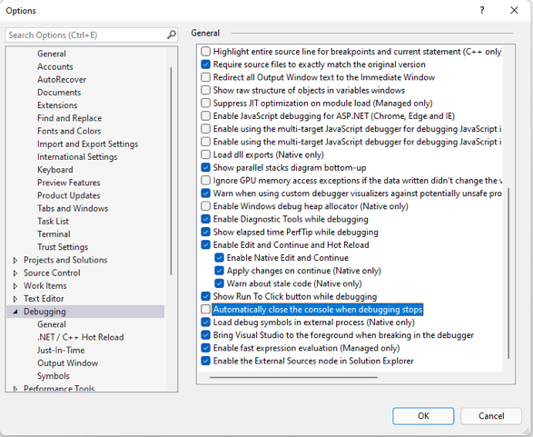

# Todo: Visual Studio 2022 - Consider to remember the setting Tools-&gt;Options-&gt;Debugging-&gt;Automatically close the console when debugging stops

```#1866116a``` *As of 2021-12-13 20:06*

[mail plain/text](mail.txt)


It was hard to find on the web and in the GUI!

But to have the console window wait for the user to press a key after debugging ends one has to **uncheck **Tools-&gt;Options-&gt;Debugging-&gt;**Automatically close the console when debugging stops**




