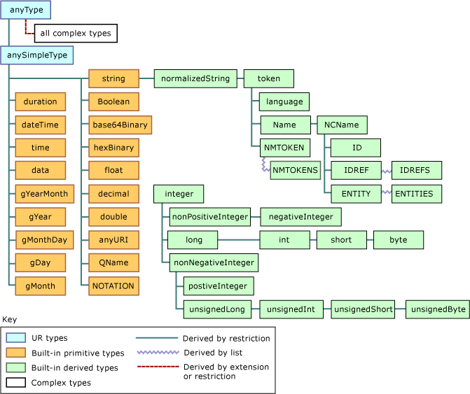

# Todo: Darwinet and Tha - Consider what we can learn about the smallest usable data model from studying existing streamable data models such as XML, YAML, JSON etc.?

```#189dda4f``` *As of 2017-08-01 14:44*

[mail plain/text](mail.txt)


Could it be a good idea to study the data models implied by existing data streaming formats like XML, JSON, YAML and what have you to get a firm small base to implement as a Tha proof of concept?

==&gt; Also see “Todo: JSon Darwinet, Meh and Tha - Consider that a Tha model and Meh syntax for Json data structures only is in fact small but complete and may serve well as a proof of concept for Darwinet implementation?”

1) Consider the Yaml “Yet Another Markup Language” data representation encoding (<https://en.wikipedia.org/wiki/YAML>)?

==&gt; Yaml seems to define a basic set of types called “scalars”?

> “*YAML natively encodes scalars (such as strings, integers, and floats), lists, and associative arrays (also known as hashes or dictionaries*"

==&gt; And these are based perl scalar types?

> “*These data types are based on the **Perl** programming language, though all commonly used high-level programming languages share very similar concepts. YAML supports both Python-style indentation to indicate nesting, and a more compact format that uses &#91;&#93; for lists and {} for hashes*"

==&gt; Yaml seem to support both its own (python like indentation encoding) and Json style composition syntax for lists &#91;&#93; and {} for objects (in yaml called hashes)?

> “*YAML supports both Python-style indentation to indicate nesting, and a more compact format that uses **&#91;&#93; for lists and {} for hashes***"

==&gt; Consider this page for the definition of Perl (Yaml) basic data types (<https://www.tutorialspoint.com/perl/perl_data_types.htm>)?

> “*Perl has three basic data types: **scalars**, **arrays** of scalars, and **hashes** of scalars, also known as associative arrays*"

==&gt; Note that arrays and hashes does not seem to nest?

==&gt; Consider this official Yaml page on the syntax (<http://www.yaml.org/spec/history/2001-12-10.html>)?

==&gt; Yes, in Yaml the structures (collections) do nest.

> > “*YAML **collections** allow for aggregation of data. There are two primary types of collections which YAML supports, **sequences** and **mappings**. Most tree structures can be constructed by **nesting** collections.*"

...

2) Consider the JSon encoding?

==&gt; Also see “Todo: JSon Darwinet, Meh and Tha - Consider that a Tha model and Meh syntax for Json data structures only is in fact small but complete and may serve well as a proof of concept for Darwinet implementation?”

3) Consider the XML encoding (

==&gt; XML per se does not define “types”, only a syntax for defining named elements or tags (<https://www.w3schools.com/xml/xml_syntax.asp>)?

==&gt; Consider this msdn graphical view of the XML Schema Data Types (<https://msdn.microsoft.com/en-us/library/ms256131(v=vs.110).aspx)?>



4) Consider UML data types (<http://www.uml-diagrams.org/data-type.html>)?

==&gt; UML seems to define a small set of “primitive” types?

> Standard UML primitive types include:
- **Boolean**,
- **Integer**,
- **UnlimitedNatural**,
- **String**,
- **Real**.


==&gt; And defines “structured data types” to those that aggregates attributes (data) and operation (member functions)?

==&gt; It seems to me that lists are modelled with the cardinality of a relation (<https://stackoverflow.com/questions/33985491/how-to-indicate-a-list-of-types-in-a-class-diagram>)?

> “*When the max cardinality is &gt; 1, the property typically gets a type that is some kind of collection in the technology*"

==&gt; Lists in UML seems to be a Collection with a Multiplicity (<http://www.agiledata.org/essays/objectOrientation101.html>)?

> “*Multiplicity A UML concept combining the data modeling concepts of cardinality (how many) and optionality.*"

==&gt; So basically UML recognises modelling of "structured types” and Collections (of same type)?

==&gt; Which in turn should map to Lists (repeated values of the same type) or objects/records (some assembly of values of different types)?

==&gt; This sis somewhat different from the view that as assembly of value elements cane be accessed either by name (records, objects, maps) or index (array, list, vector)?

...

5) consider ASN.1 “Abstract Syntax Notation One” (<https://en.wikipedia.org/wiki/Abstract_Syntax_Notation_One>)?

==&gt; It seems ASN.1 is a kind of “language” that defines protocols data exchange encoding as well as exchange rules?

> “*Protocol developers define data structures in ASN.1 modules, which are generally a section of a broader standards document written in the ASN.1 language. Because the language is both human-readable and machine-readable, modules can be automatically turned into libraries that process their data structures, using an ASN.1 compiler.*"

==&gt; It seems ASN.1 “code” aims at being readable to both humans and ASN.1 compilers?

==&gt; Consider this list of free online downloadable books about ASN.1 (<http://www.oss.com/asn1/resources/books-whitepapers-pubs/asn1-books.html>)?

==&gt; Hm…The “types” of ASN.1 seems cluttered, e.g., they seem to mix structure, composition and representation into types (<https://www.obj-sys.com/asn1tutorial/node10.html>)?

> ### [Simple Types]()

>  ASN.1's built-in simple types are shown in the following Table <https://www.obj-sys.com/asn1tutorial/node10.html#asn1_simple>. The universal class number (tag) and a typical use of each type are also included.

> **Simple Types****Tag****Typical Use**`BOOLEAN`1Model logical, two-state variable values`INTEGER`2Model integer variable values`BIT STRING`3Model binary data of arbitrary length`OCTET STRING`4Model binary data whose length is a multiple of eight`NULL`5Indicate effective absence of a sequence element`OBJECT IDENTIFIER`6Name information objects`REAL`9Model real variable values`ENUMERATED`10Model values of variables with at least three states`CHARACTER STRING`\*Models values that are strings of characters from a specified characterset

==&gt; Consider this complete list of ASN.1 “Universal Tags” (types?) (<https://www.obj-sys.com/asn1tutorial/node124.html>)

> ### Listing of Universal Tags

> **Universal Tag Number****Description**0reserved for BER1BOOLEAN2INTEGER3BIT STRING4OCTET STRING5NULL6OBJECT IDENTIFIER7ObjectDescriptor8INSTANCE OF, EXTERNAL9REAL10ENUMERATED11EMBEDDED PDV12UTF8String13RELATIVE-OID16SEQUENCE, SEQUENCE OF17SET, SET OF18NumericString19PrintableString20TeletexString, T61String21VideotexString22IA5String23UTCTime24GeneralizedTime25GraphicString26VisibleString, ISO646String27GeneralString28UniversalString29CHARACTER STRING30BMPString

…

Consider to update this Todo: if appropriate for any insights into what constitutes a good small set meta information to represent (model) data in an efficient way?

...


