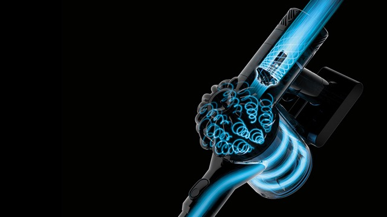

# Todo: DIY Dust Cyclone - Consider to understand Dyson vacuum to design a good dust cyclone separator?

```#18c5550c``` *As of 2017-12-02 20:34*

[mail plain/text](mail.txt)


So, what can we learn from studying the Dyson cyclone design to use as input to my own cyclone dust separator?

1) Consider this youtube video “BOLTR: Dyson Animal | Cordless Vacuum” that shows a design disassembly (<https://www.youtube.com/watch?v=i0Rens9oKb4>)?

==&gt; It seems to have two stage cyclones (The main outer one and a ring of smaller inner ones)?

==&gt; He seems to show how it works at 6:10 (<https://youtu.be/i0Rens9oKb4?t=371>)?

==&gt; The outer body seems to be transparent acrylic with the inner cyclones kind of hidden in the center tube?


==&gt; The air seems to enter the main chamber in a “cyclone” way?


==&gt; The air seems to go upp the center of the inner cyclones?


==&gt; The air then enters the inner cyclones from the top (cyclone style)?


==&gt; The cyclones seems to be vented from the top center of each inner cyclone (and out through the impeller)?


==&gt; NOTE: My dyson model seems different but basically the same design (but with filer mounted in centre outlet?

2) Consider this youtube video showing how to disassembly (my actual dyson) - the parts that are not glued (<https://www.youtube.com/watch?v=N67PVoZlJ9I>)?

==&gt; I seems to need a T8 Torx screw driver?

==&gt; He does not show the workings of the inner cyclones (they are glued)

==&gt; BUT - There seems to be no less than **15 (fifteen!)** inner cyclones!!

…

3) Consider this image on dyson ([https://www.dyson.com.sg/medialibrary/Group/Carousels/SlideBackground/Vacuums/Cordless/V6%20Cordless/V6%20Motorhead%20JP/Motorhead_DDM.ashx](<https://www.dyson.com.sg/medialibrary/Group/Carousels/SlideBackground/Vacuums/Cordless/V6 Cordless/V6 Motorhead JP/Motorhead_DDM.ashx>) )?



4) Consider to build my own multi-cyclone using heat moulded acrylic pipes for the inner cyclones?

==&gt; Consider this acrylic online provider (<http://www.plexiglasshopen.se/plexiglasror> and <http://www.plexiglasshopen.se/ofargade-plexiglasplattor>)?

…

5) It seems we may mimic the Dyson multi-cyclone design?

==&gt; Let the air enter cyclone-way into the main outer cyclone?

==&gt; Then vent trough an inner inlet to the inner cyclones?

==&gt; Let the inner cyclones exit at the bottom isolated from the outer cyclone (as dyson inner cyclones does)?

…

…

Consider to delve into this idea to design and build my own multi-cyclone dust separator?

...


