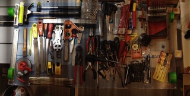
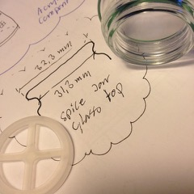

# Todo: Consider designs to store tools on wall storages in my indoor shed (preferably transparent to let in light into the shed)?

```#18fb4e2b``` *As of 2018-12-16 15:36*

[mail plain/text](mail.txt)


It seems I have a journey to make in my mind to come up with good and efficient ways of hanging and storing tools and materials hanging of the walls of my indoor shed?

==&gt; Also see “Todo: Consider to reverse engineer adhesives for bonding different materials to LSE (low surface energy) plastics from this adhesive selection guide from SCIGrip vendor?"

==&gt; Also see “Todo: Consider an acrylic tube based hinged compartment tower for screws and nuts and other fasteners and small things?”

==&gt; Also see “Todo: Consider to research about plastic sheets materials and explicitly the difference between PVC and Poly(methyl methacrylate) (PMMA), also known as acrylic or acrylic glass (branded Plexiglas)”

==&gt; Also see “Todo: Consider what we need to know to glue PLA to Acrylic or PVC (e.g. 3D printer parts to transparent sheets of plastic)”



1) Consider ways I can design storage and fasteners using acrylic pipes?

==&gt; Consider acrylic pipe on to which the caps from my spice glass jars will fit?



==&gt; It seems Plexiglasshopen has no 31…32 mm fitting pipe , only has 30 or 40 mm outer diameter pipes (<https://www.plexiglasshopen.se/plexiglasror>)?

==&gt;

2) Consider ways to hang drills together with labels to easily find drills for correct material and correct diameter?

…

3) Consider ways to hang pliers for easy identification and access?

…

4) Consider ways to hang drill bits and screw drivers for easy identification and access?

…

5) Consider what we can buy and use to organise and store tools, components and materials for easy access and identification?

==&gt; Consider this IKEA set of semi-transparent boxes (<https://www.ikea.com/se/sv/catalog/products/60149673/>)?


<https://www.ikea.com/se/sv/catalog/products/60149673/>


<https://www.ikea.com/se/sv/catalog/products/90335843/>


<https://www.ikea.com/se/sv/catalog/products/20152870/>


<https://www.ikea.com/se/sv/catalog/products/40064702/>


<https://www.ikea.com/se/sv/catalog/products/40323654/>


<https://www.ikea.com/se/sv/catalog/products/60391350/>


<https://www.ikea.com/se/sv/catalog/products/10328182/>

“Innehåller: 2 st 15 ml, 4 st 40 ml och 2 st 90 ml."

NOTE: These are 8 bottles (but i may cut them open for small part storage?

NOTE: The transparent bag may also be used for storage?

NOTE: There is also a small funnel in the set (that can be used for handling a screw driver?


<https://www.ikea.com/se/sv/catalog/products/90328178/>

“Innehåller: 3 st 26x9x3 cm och 2 st 26x16x9 cm och 1 st 34x25x9 cm."


<https://www.ikea.com/se/sv/catalog/products/80282067/>

  
> Höjd: 21.5 cm  
> Diameter: 3.5 cm  
> Antal i förpackning: 4 styck


<https://www.ikea.com/se/sv/catalog/products/80334919/>

  
> Bredd: 56 cm  
> Höjd: 26.5 cm


<https://www.ikea.com/se/sv/catalog/products/00334923/>


<https://www.ikea.com/se/sv/catalog/products/20334922/>

==&gt;


