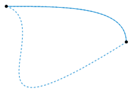

# Todo: Consider to delve into SET Theory, Martin Lööv Type Theory and Homotopy Theory and its off spring Homotopy Type Theory and Computer Programming?

```#195923ff``` *As of 2019-06-22 11:54*

[mail plain/text](mail.txt)


Delving into Type Theory and trying to extract out the essence in C++ Tha and General Meta layer model of type systems it seems to me SET Theory, Type Theory and Homotopy Theory is worth delving into?

1) Consider this youtube video "Computer Science ∩ Mathematics (Type Theory) - Computerphile" with Dr Thorsten Altenkirch (<https://www.youtube.com/watch?v=qT8NyyRgLDQ> )?

2) Consider my own intuitions at this stage of my research?

> *For me there seems to be a close relationship between cause-and-effect in our observation of "reality" (the physical world) and in Logic. To the degree that Logic is just a representation in a language of the cause-and-effect in "reality". Logic is a language in which we can talk about (model) things to be of this or that "type". *

> *So logic seems to be about the smallest form of categorisation we can do. Something is of this category or of that category and we call this true or false.*

> *Mathematics now becomes an extension of logic in that mathematics is a language to represent multiple categories each with multiple members. We call this SET theory. But basically SET theory is "just" an abstract way of naming members identified to belong to the same SET. Someone in the history of time noticed that you could "compute" if there were a fruit for every member of the tribe by assigning a "number" to each fruit and to each member of the tribe. And if the last assigned fruit and tribe member got assigned the same number, then there were enough fruits for each member to get one.*

> *The Curry-Howard seems to "just" state that the cause-and-effect in logic to compute relationship between propositions and conclusions is "the same thing as" (is isomorphic to) a variable holding values defined by a type. To me my intuition tells me this us so because a variable being able to hold a value defined by the SET of values defined by its type surely corresponds to a proposition being able to be an instance of a SET of proofs for this proposition? You just have to observe the cause-and-effect mappings between the instance and the SET to convince yourself this must be so? *

> *When Dr Thorsten Altenkirch talks about Homotopy as the theory of continuous transformations and two things being equal if the transform in the "same way" I can't help to notice the suspicious likeness with Category Theory where objects are identified convergent relationships? So in Category Theory the empty object is the object everything relates to but which itself relates to nothing. In the space of all possible relationships you identify objects as "hubs" of converging relations. Surely there is some strong isomorphism going on here between category Theory and Homotopy Theory?*

> *To me reasoning seems to be an abstraction to enable us to compute how reality may transform in presence of time using a model of reality that predicts cause-and-effect relationships. So, when we reason we are trying to tie together events into chains of reality transformations. Like - if I cut this wooden branch into half I will get a poking tool such that if I put it into the whole of a termite stack ants will bite on to it and I can withdraw the stick and eat them. Now, this must surely be isomorphic to say Category Theory of morphisms (events) between objects (similar states of reality) or to SET theory of functions (events) mapping members of SETs (similar states of reality)? *

2) Consider wikipedia on SET theory (<https://en.wikipedia.org/wiki/Set_theory> )?

> *"Set theory is a branch of mathematical logic that studies sets, which informally are collections of objects. Although any type of object can be collected into a set, set theory is applied most often to objects that are relevant to mathematics. The language of set theory can be used to define nearly all mathematical objects."*

3) Consider wikipedia on Mathematical Object (<https://en.wikipedia.org/wiki/Mathematical_object> )?

> *"*  
> *In mathematical practice, an object is anything that has been (or could be) formally defined, and with which one may do deductive reasoning and mathematical proofs. *

> *Commonly encountered mathematical objects include:

> *  
> *• numbers, integers, integer partitions.*  
> *...*

> *Set theory (a branch of mathematics) has such objects as:

> *  
> *• sets, set partitions,  
> *  
> *• functions, and relations.*

> *...*

> *Abstract algebra (a branch of mathematics) has such objects as:

> *  
> *• groups,  
> *  
> *• rings, modules,  
> *  
> *• fields, vector spaces,  
> *  
> *• group-theoretic lattices, and order-theoretic lattices."*

3) Consider wikipedia on Type Theory (<https://en.wikipedia.org/wiki/Type_theory> )?

> 

4) Consider wikipedia on Intuitionistic type theory, Martin-Löf type theory or Constructive Type Theory (<https://en.wikipedia.org/wiki/Intuitionistic_type_theory> )?

> 

5) Consider wikipedia on the Curry-Howard Correspondence also called "propositions as types" ([https://en.wikipedia.org/wiki/Curry–Howard_correspondence](https://en.wikipedia.org/wiki/Curry%E2%80%93Howard_correspondence) )?

> *"The beginnings of the Curry–Howard correspondence lie in several observations:*

> *• In 1934 Curry observes that the types of the combinators could be seen as axiom-schemes for intuitionistic implicational logic.&#91;3&#93;  
> *  
> *• In 1958 he observes that a certain kind of proof system, referred to as Hilbert-style deduction systems, coincides on some fragment to the typed fragment of a standard model of computationknown as combinatory logic.&#91;4&#93;  
> *  
> *• In 1969 Howard observes that another, more "high-level" proof system, referred to as natural deduction, can be directly interpreted in its intuitionistic version as a typed variant of the model of computation known as lambda calculus.&#91;5&#93;  
> *  
> *In other words, the Curry–Howard correspondence is the observation that two families of seemingly unrelated formalisms—namely, the proof systems on one hand, and the models of computation on the other—are in fact the same kind of mathematical objects."*

6) Consider wikipedia on Homotopy Theory ()?



*The two dashed paths shown above are homotopic relative to their endpoints. The animation represents one possible homotopy (<https://en.wikipedia.org/wiki/File:HomotopySmall.gif> )*

> *"In topology, two continuous functions from one topological space to another are called homotopic (from Greek ὁμός homós "same, similar" and τόπος tópos"place") if one can be "continuously deformed" into the other, such a deformation being called a homotopy between the two functions."*

7) Consider wikipedia on Homotopy Type Theory (<https://en.wikipedia.org/wiki/Homotopy_type_theory> )?

> 

8) Consider wikipedia on Category Theory (<https://en.wikipedia.org/wiki/Category_theory> )?


> *"Category theory&#91;1&#93; formalizes mathematical structure and its concepts in terms of a labeled directed graph called a category, whose nodes are called objects, and whose labelled directed edges are called arrows (or morphisms). A category has two basic properties: the ability to compose the arrows associatively, and the existence of an identity arrow for each object."*

> *"**Informally, category theory is a general theory of functions.**"*

...


