# Todo: Consider to document that I need to configure each Git repository with the appropriate SSH public keys to allow local git client (e.g., TortoiseGit) to be allowed to access it?

```#19e55456``` *As of 2021-05-05 15:20*

[mail plain/text](mail.txt)


**Att det skall vara så svårt att förstå hur TortoiseGit, Putty och OpenSSL sammarbetar kring privat och publik nyckel och lösenordet till min publika nyckel?**

==&gt; Also see "TestBench - Consider to try out Git using TortoiseGit and beanstalapp git repository?"

1) It seems my public key is stored in id_rsa.pub file (in “C:\\Users\\kjell-olovhogdahl\\.ssh”)?

2) I seems I need to cut and paste the public key into the SSH configuration of my git repository web interface (e.g., Beanstalkapp or GitHub)?

==&gt; In Beanstalkapp Repository main page I clicked "Add SSH Key"

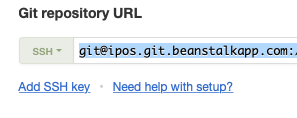

==&gt; To gain access I needed to re-enter my password

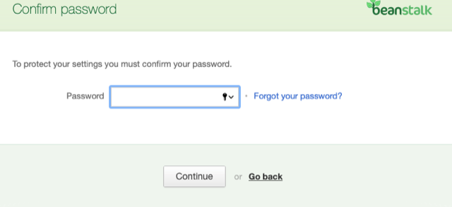

==&gt; I then pressed &lt;Add Public Key&gt;

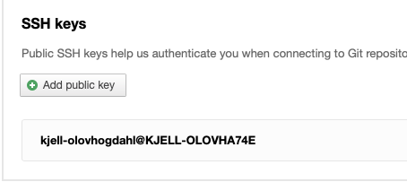

==&gt; I now got a dialog where I had several options on how to add a public SSH key

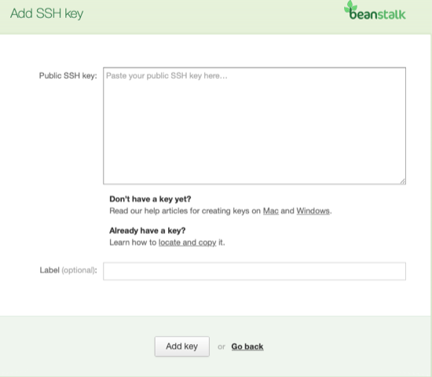

==&gt; I clicked the "Learn how to locate and copy it" and got an instruction to open a pub-file and use notepad to cut-and-paste it

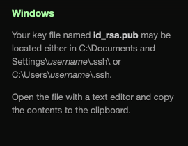

==&gt; I used windows expolrere "right-click" and open-woth to open the pub-file with notepad

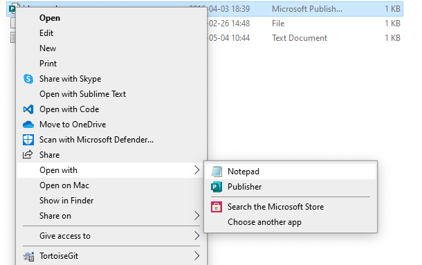

==&gt; I pasted the content (my public key) and pressed &lt;Add Key&gt;

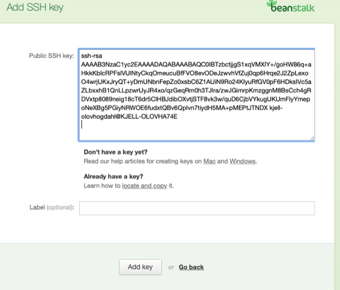

ERROR! It seems I can not use the same key for different repositories?

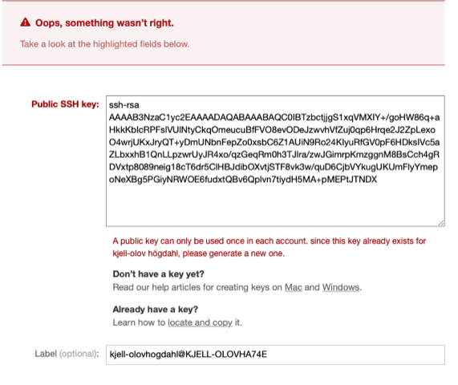

==&gt; It seems the problem is actually I have not configured a Password to allow access to the SSH public key?

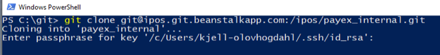

==&gt; WhenI use the powershell and git command line i get asked for the SSH password

==&gt; It seems it is not only the SSH password that is missing?

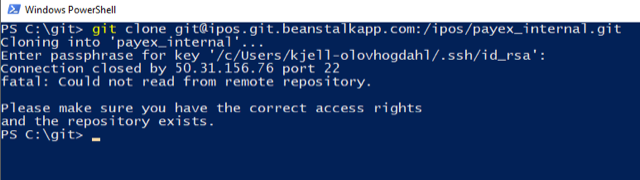

==&gt; Strange thing is that trying to clone the previously used repository the credentials seems to work "better" (but something still fails)?

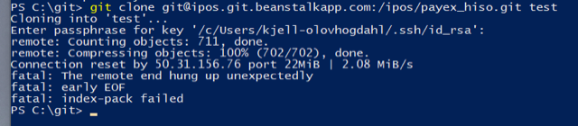

==&gt; BUT: Trying a second time (with argument ./test) it seems to nor work (wrong filder argument or just bad luck the first time?)

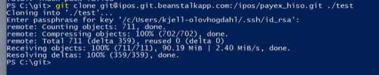

==&gt; BAD LUCK: I can clone the previously existing repository with the passphrase to the SSH key.

PS C:\\git&gt; **git clone** [git@ipos.git.beanstalkapp.com](mailto:git@ipos.git.beanstalkapp.com):/ipos/payex_hiso.git test

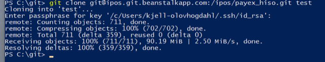

==&gt; SIGH: Now I am able to clone aslo the new repository!!

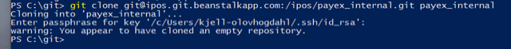

==&gt; SUCCESS: I Could now clone a bare repository!

> PS C:\\git&gt; **git clone --bare** [git@ipos.git.beanstalkapp.com](mailto:git@ipos.git.beanstalkapp.com):/ipos/payex_internal.git payex_internal/bare  
> Cloning into bare repository 'payex_internal/bare'...  
> Enter passphrase for key '/c/Users/kjell-olovhogdahl/.ssh/id_rsa':  
> warning: You appear to have cloned an empty repository.  
> PS C:\\git&gt;

3) Consider the TortoiseGit help on SSH and Putty to make things "easier" (<https://tortoisegit.org/docs/tortoisegit/tgit-ssh-howto.html> )?


