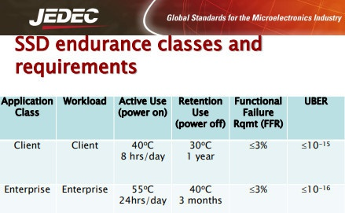

# Todo: Consider to use HDD as long time storage backups as SSD disks degrade when not powered?

```#1a952f70``` *As of 2021-03-17 21:28*

[mail plain/text](mail.txt)


1) Consider this article that seems to state a consumer SSD degrade in 12-24 months if not powered (<https://www.quora.com/How-long-can-SSD-store-data-without-power-Can-data-be-recovered-from-SSD> )?

>   
> *"**JEDEC specifies 1 year for consumer SSDs and 3 months for enterprise SSDs, at normal operating temperatures (30C).**"*

...


