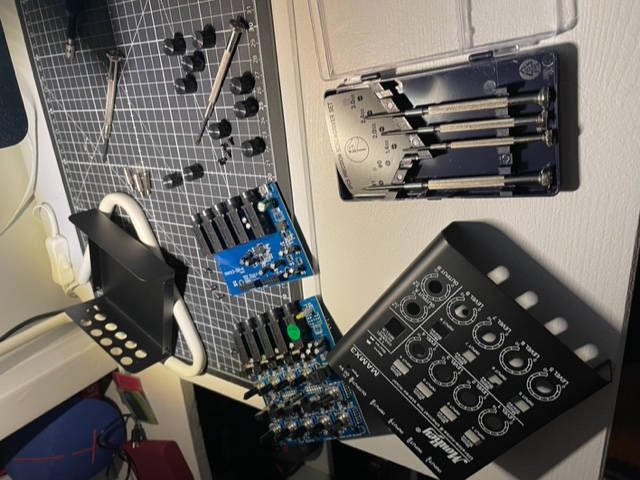
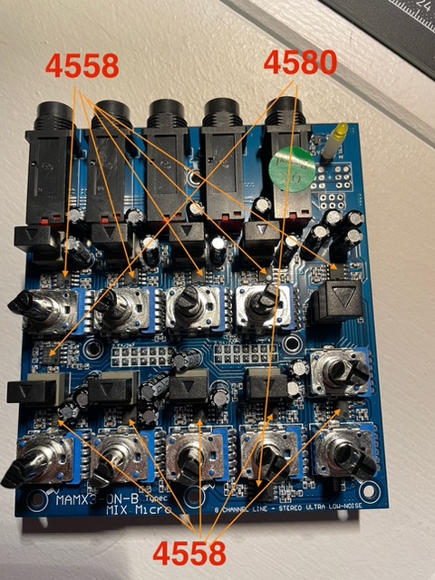
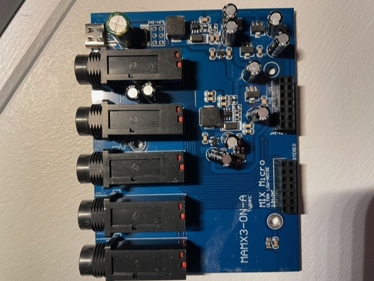

# Todo: Consider the MouKey MAMX3 4 stereo channel line mixer is actually made with fairly good components?

```#1aba2002``` *As of 2024-03-16 20:53*

[mail plain/text](mail.txt)


After a long winding road through the web to find a Line mixer for my three synths I landed on the MouKey MAMX3 8 mono / 4 stereo channel line mixer.

1) Consider I found two JRC 4580 and ten (!) RC4558 in the mixer?



Disassembled...



Top PCB with OP-amps and potentiometers...



Bottom PCB with, I speculate, the +5V to +/-VCC power supply?

...


