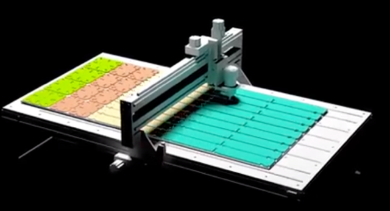
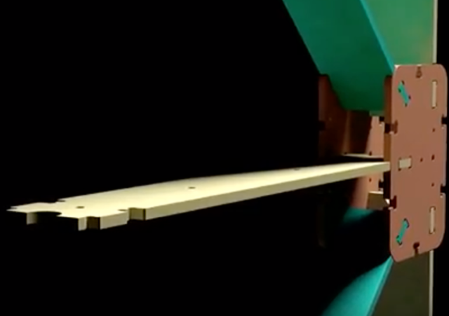
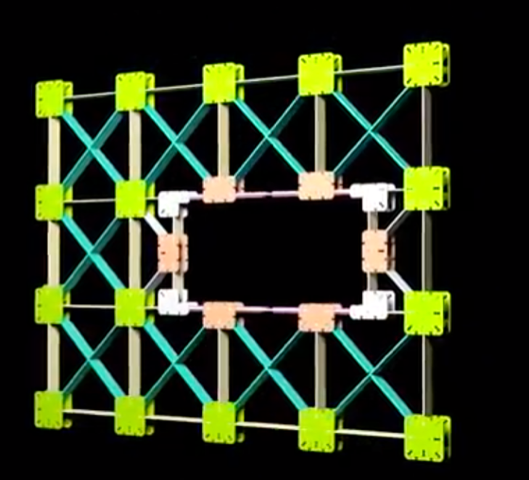
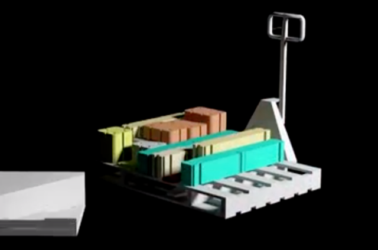
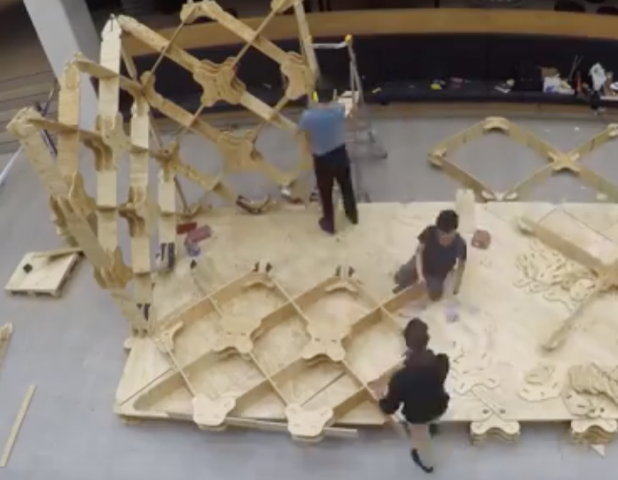

# Todo: House Build - Consider New Zeeland PhD Ged Finch CNC cut plywood X-Frame (XFrame?) system for my own house build (frame and sheeting)

```#1b7dee00``` *As of 2019-09-18 22:20*

[mail plain/text](mail.txt)


It seems New Zeeland PhD Ged Finch has developed XFrame that in the same way as WikiHouse is a system of CNC cut playwood parts that assembles into house frame and cladding?

1) Consider this youtube video "Why we need to rethink how we build homes | Ged Finch | TEDxWellington" (<https://www.youtube.com/watch?v=5RrEJMMiI9w> )?

>   
> *Like Wikihouse all parts are cut using a CNC from standard plywood sheets*

>   
> *The X-Frame parts come together using only "simple tools"*

>   
> *The X-Frame parts are designed to come together in many many configureations*

>   
> *The X-Frame parts are designed to pack into standard "flat" pallets*

2) Consider this site is potentially where the "Defab" project lives that is the core of PhD Ged Finch thesis and research into zero waste house construction system (<https://gerardfinch.com/defab> )?

190918 - I Registered for updates on XFrame here (<https://gerardfinch.com> )

3) Consider this youtube video "Designing for Deconstruction | Pt. 3 | X-Frame" (<https://www.youtube.com/watch?v=JXebJE3NQWw> )

> 

==&gt; It seems the CNC parts consist of only three main forms?

> *"Furthermore the structure relies on only 3 main elements - resulting in a simple and easily expandable geometry. "*

4) Consider Ged Finch youtube channel (<https://www.youtube.com/channel/UCTRRG-tQOXgJK0yjut69dKA> )?


