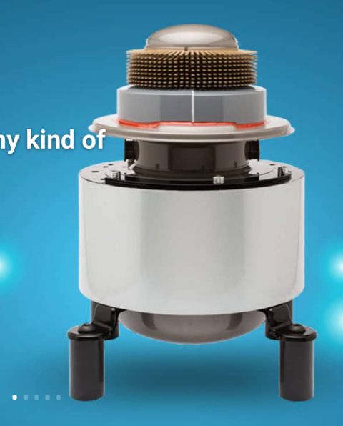
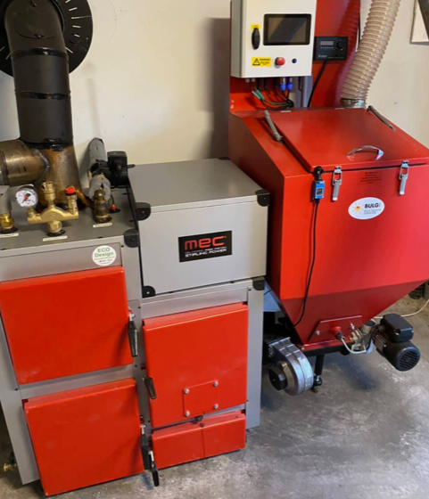

# Todo: Consider the 12 kW thermal and 1 kW electric version Stirling engine from the Netherland stationed Microgen Engine company?

```#1c4ca39e``` *As of 2024-09-14 20:40*

[mail plain/text](mail.txt)


I want to turn heat into electricity and a Stirling engine drive electric generator may be the thing.

==&gt; Also see "[Todo: House Build - Consider to find options to generate electricity from burning wood e.g., using a string engine driven generator?](../bff71726/chime.md)"

1) Consider the free piston Stirling engine products by Netherlands based company Microgen Engine Corporation (<https://www.microgen-engine.com> )?



2) Consider the article "First AllGen Biomass Installations in Germany and Sweden" on an installation in Sweden and Germany (<https://www.microgen-engine.com/news-information/news/first-allgen-biomass-installations-in-germany-and-sweden/> )?



...


