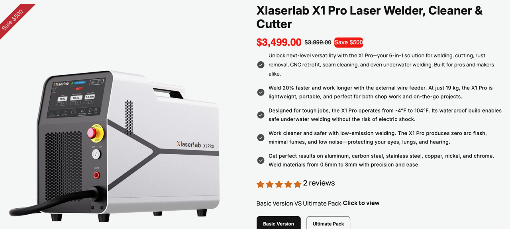
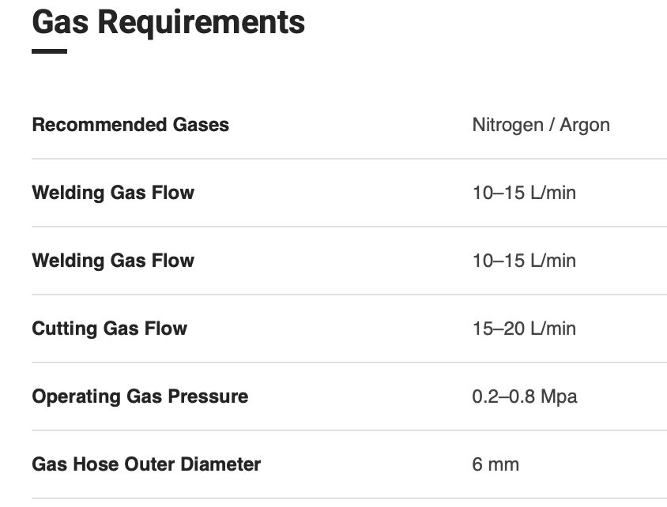

# Todo: Consider to buy and learn to use a Desktop Laser Welder?

```#1c7ac798``` *As of 2025-10-19 13:24*

[mail plain/text](mail.txt)


I want to be able to weld stuff together in a secure and easy to learn way.

1) Consider youtube video "DIY Laser Welding: Pro Results at Home" (https://youtu.be/lOrQDVxLGIA?list=LL )?

==&gt; It seems he shows the "Xlaserlab X1 Pro Laser Welder, Cleaner & Cutter" for $3500 + shipping from US (https://www.xlaserlab.com/products/xlaserlab-x1-pro-laser-welder-cleaner-cutter?source=aw&utm_source=awin&utm_id=2581519_&utm_campaign=affiliate&awc=118933_1760872788_faba8237cba9006e16c862a1bc5051a3 )?



==&gt; It seems to require Nitrogen or Argon as protective gas shield

> 

...


