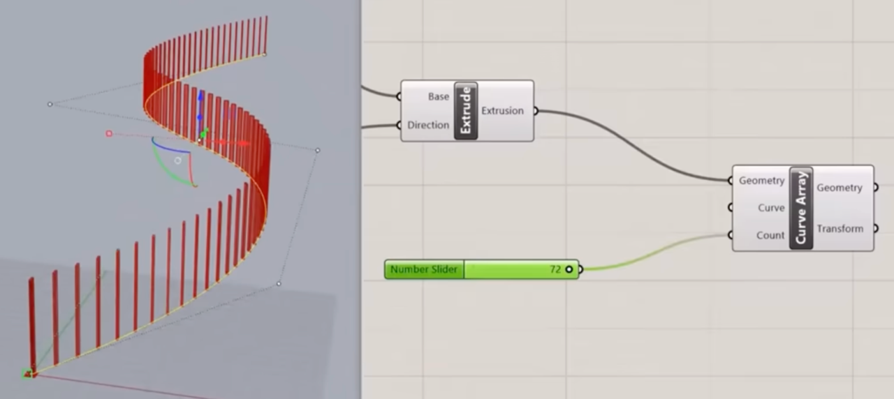
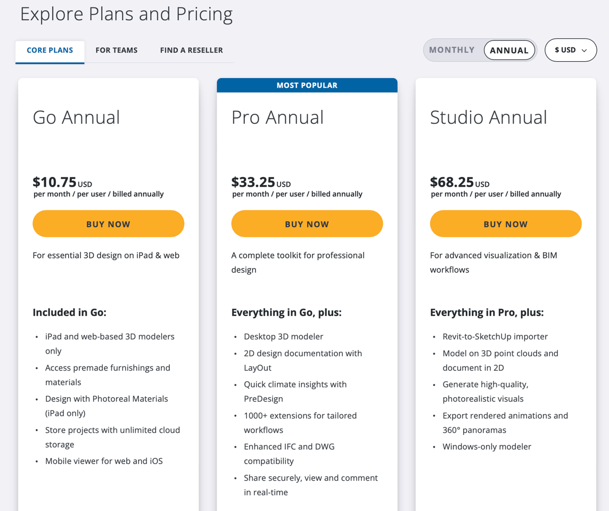
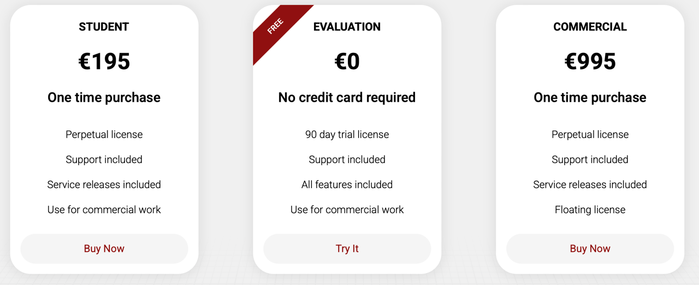

# Todo: Consider how 'Rhino' compares to 'Sktechup' and possibly FreeCad for modelling my own house design?

```#1cca7de3``` *As of 2025-10-27 17:51*

[mail plain/text](mail.txt)


I need a tool to model my own house build.

1) Consider youtube video "Is SketchUp being REPLACED?" (https://youtu.be/rb385302GzA )?

==&gt; Consider the listed chapters in the video description?

> TIMESTAMPS  
> [0:00](https://www.youtube.com/watch?v=rb385302GzA) - Introduction/The Problem  
> [0:40](https://www.youtube.com/watch?v=rb385302GzA&t=40s) - The Three Problems SketchUp has  
> [1:15](https://www.youtube.com/watch?v=rb385302GzA&t=75s) - The User Pipeline Problem  
> [2:38](https://www.youtube.com/watch?v=rb385302GzA&t=158s) - The Missing Feature Problem  
> [4:29](https://www.youtube.com/watch?v=rb385302GzA&t=269s) - The Negative Feedback SketchUp has been getting  
> [5:32](https://www.youtube.com/watch?v=rb385302GzA&t=332s) - The Parametric Modeling Problem  
> [6:30](https://www.youtube.com/watch?v=rb385302GzA&t=390s) - Is it too late?

=&gt; The presenter seems to judge Rhinos 'parametric modelling' to 'clunky' but powerful and useable (https://youtu.be/rb385302GzA?t=358 )



2) Consider what we can say about the 'Rhino' application as option for my house modelling needs?

==&gt; It seems 'Go' is web based and $142 'Pro' is desktop and $34\*12 and 'Studio' supports import/export models for $70\*12 annually (https://sketchup.trimble.com/en/plans-and-pricing )?

**NOTE: Only subscriptions available! \*sigh\***



3) Consider what we can say about the 'Rhino' application as option for my house modelling needs?

==&gt; It seems the Rhino app lives here (https://www.rhino3d.com )?

**Note: One time perpetual license available = GOOD!**



==&gt; Consider to try the 90 days evaluation license?

...


