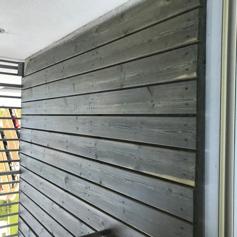
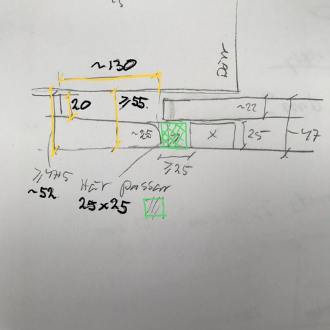
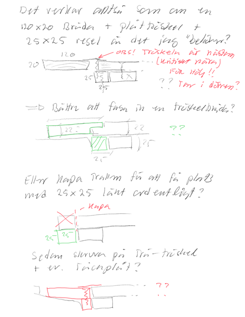

# Todo: Consider - for me to get anything done I need to break down the tasks into ones that takes one hour or less in effort (the more boring the shorter concentration span I seem to have)?

```#1d40d0ce``` *As of 2019-06-16 12:31*

[mail plain/text](mail.txt)


Could it be that I have to accept I have a very short concentration span in general and even less for tasks I find meaningless, tedious or uninteresting?

1) Consider one thing that often keeps me procrastinating is the fear of wasting time on the "wrong" thing?

> *I want to spend more time on transforming reality so that it becomes how I feel it should be and spend less time procrastinating and feeling anxious spedning time fleeing from doing stuff. I feel strongly I could spend much more time being productive on meaningful tasks than I currently am. Although it could be much worse (I could spend time on playing games or watching TV series) I am still binge watching youtube videos that youtube suggests to me rather than deciding what to watch or do based on my own inner agenda!*

==&gt; Consider how I should value time I spend more or less on "research" although the research I do is more spontaneous and less planned?

> *Every day starts off after breakfast with me making coffee and drink it watching youtube videos. At this stage I have a very strong resistance to sit down and plan my day. I just want to flee in to youtube and endulge myself in things I find fascinating and interesting. It is undoubtedly so that this activity is almost never in line with making any progress in the tasks I have ongoing (like right now painting my wall, fixing the balcony floor on my path to selling my apartment and buy a property to build a house). And I would say every time I have forced myself to finish my coffee and sit down to work on what is at hand I always find I can do this. It is just that it is soo painful! If for example I have to do some paper work in my firm I can do this. And I feel good when I manage to get it done. But the memory of the pain always supersedes my memory of the success.*

> *Could it be that I actually do not value completing tasks I do not find meaningful? Tasks that are forced upon me by external necessity I dread to do. Tasks like doing paperwork in my company, cleaning the apartment, exercise or do the washings just feels a waste of time. These tasks just helps me remain on status quo. It does not change anything for the better. They just prevents things to change to the worse. And that I have a hard time to accept. I do not like to model reality to have forces that deteriorate my reality and that I have to fight these forces and part of my daily routines and life? Ouch - yes, this sucks. But I have to accept it as part of staying alive!*

2) Consider I need a way to perform tasks that allows me to quickly start and stop without loosing pace?

> *The theory here is that if I can only concentrate on a single task for an hour or less I need ways to work in one hour or less and then easily and efficiently "park" the task to pick it up later. For this to be possible I need a quick and easy way to get to the tools I need for a task and also an equally easy and quick way to organise reality so that the task can be worked on. The latter means that while I am not working on a task it must not "be in the way" of other tasks. So generally I need methods and storage available to "park" the tools and the physical reality of the project "out of sight" while I am not working on it.*

3) Consider the task of fixing the balcony floor?

> *Let say I want to be able to work on the balcony floor fixing in efforts of one hour or less in a way to that nothing is in the way in between such work? For one I need the tools I use to have a home and to be able to put them back in their home quickly and conveniently?*

> *The "balcony fix" task started with me identifying I should do something about it. I had just gotten used to not being able to open the balcony door without having it scrape the floor on hot days. I was in effect blind to this obstacle. And I did not identify it to be of priority until I started to focus on making my apartment fit for selling.*

> *So even the task of identifying what in reality that are obstacles takes an effort. And as such is a task I don't do unless I force myself to do it.*

> *After having written down the goal to fix the balcony floor I entered the task of figuring out what to do. This required me to produce a solution which I to some degree dreaded and at the same time found intriguing. I found the hardest part to actually take measurements to be the most tedious task. For one I had a hard time knowing what to measure, as in what would turn out to frame my possible solutions? To complicate things even further I did not find good ways to take the measurements. Should I use a ruler? Did I need a calliper? Should I measure the height from the balcony concrete floor or from the door threshold or both. How should I cope with sides and planes that were not straight or square? And finally, how should I document all these measurements so I could use them when imagining a solution?*



*My balcony flooring bends up on hot days and conflicts with the door opening (notice the scratch marks)*



*My try to put down (model) the measurements of my balcony flooring towards the balcony threshold*



*My notes (thinking out loud) on possible ways to solve the balcony flooring "hot day raise" problem*

4) Consider how much time I loose by having to switch tasks so often and being unable to switch easy and conveniently?

> *Bodil Jönsson in "Tio tankar om tid" (Ten Thought about time) identified the time we spend on switching tasks as considerable and also hidden. So if I have an urge to switch tasks every hour I should be loosing lot of time? So maybe, the reason things seems to go so slowly for me is because I waste a lot of time on task switching? And what I should focus on is, if possible, spend longer continuous time on each task. And it that is not possible, minimise the task switching time and effort?*

...


