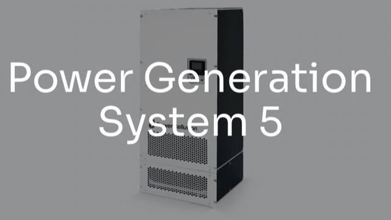

# Todo: Consider to check out Fuel Cells from Swedish Manufacturer PowerCellution?

```#1e08969a``` *As of 2021-06-24 22:51*

[mail plain/text](mail.txt)


==&gt; Also see "Todo: Consider to try and buy a Toyota Mirai to get hold of the Fuel cell to use to power my off-grid house?"

==&gt; Also see "Todo: House Build - Consider to use the Hydrogen energy storage system RE8760 developed by "Nilsson Energy AB"?"

1) It seems PowerCellution sells as small as 5 kW fule cells in 19" rack format (<https://powercellution.com/power-generation-system-5> )?



- Scope of delivery  
>   Fuel Cell Stack Converts hydrogen into electrical energy in a clean and efficient wayHydrogen SubsystemManages cooling and produces heat that can be utilized for external usesCooling SubsytemManages cooling and produces heat that can be utilized for external usesAir SubsystemRegulates incoming air to a specific humidity, flow rate,pressure and temperatureFC Safety SystemPassive and active protections based around continuous monitoring and control of the systemFC Control SystemProcess monitoring and control within the fuel cell systemCooling ModuleConnects the stack cooling to a heat exchanger enabling a closed loop interfaceElectronics ModuleConverts and stabilizes voltage output from the fuel cell stack Air FilterProvides chemical filtration of air feed to match the requirements of the fuel cell stack

2) It seems Hans-Olof Nilsson uses fuel cells from PowerCell in his hydrogen electrolysis home powering system (<https://www.elinstallatoren.se/2017/12/branslecell-i-kallaren-nu-ar-det-vatgasdrift-som-galler/> )?

> "...Bränslecellen har också byts ut från den tidigare prototypen till en färdig produkt från Powercell, säger Hans-Olof Nilsson."

...


