# Todo: Consider a "sliding wall" workspace based on extruded aluminium and rollers?

```#1ee9d0f8``` *As of 2021-07-28 13:30*

[mail plain/text](mail.txt)


I want to try out a "sliding wall" design to stove away a compact wood working workspace and maybe I can design the sliding mechanism from extruded aluminium profiles?

1) Consider parts from Swedish based RS Components?

==&gt; Consider the 2m 40x40 I-profiles (<https://se.rs-online.com/web/p/tubing-and-profile-struts/7613313/> )?

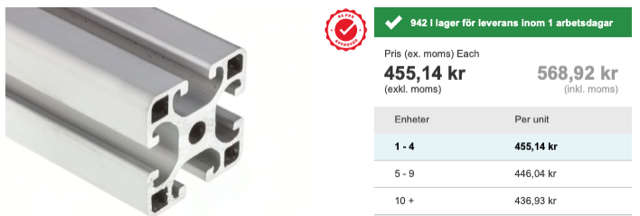

==&gt; Consider the rollers (<https://se.rs-online.com/web/p/products/7675743/> )?

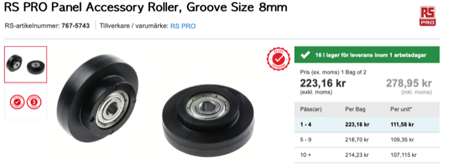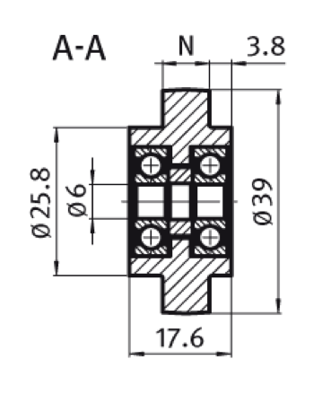

==&gt; Consider an 11 mm groove and guide wheel (<https://se.rs-online.com/web/p/linear-motion-components/2612419/> )

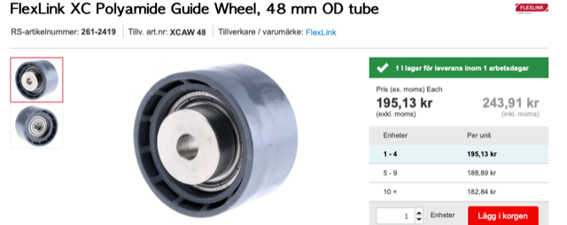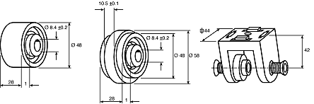

==&gt; Consider an 11 mm groove and guide wheel (<https://se.rs-online.com/web/p/tubing-and-profile-struts/2489578/> )?

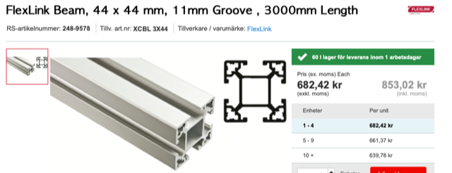

3) Consider the "Structural System RC" from RS Components for linear motion systems (<https://docs.rs-online.com/e213/0900766b8002723b.pdf> )?

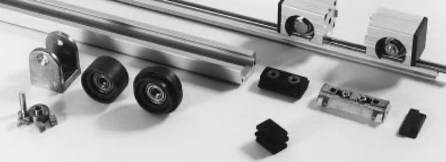

> *"**Structural system XC includes one sliding element which uses the T-slot for guidance and two which use a special guide profile. The sliding elements are not de- signed to withstand bending moments. Therefore, al- ways use two parallel slides to convert any moment into a centered force.**"*

> 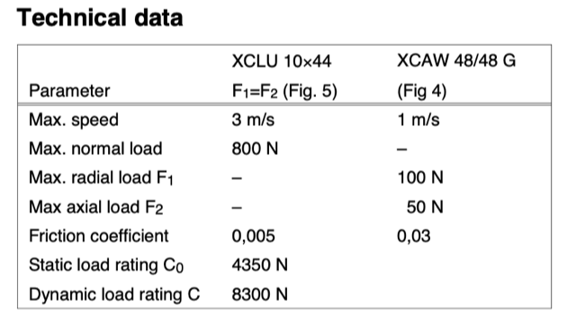  
> 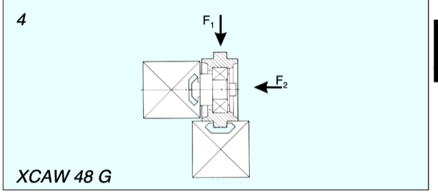  
> It is a bit unclear but each wheel seem to be able to take 10 kg weight (100N)?

> 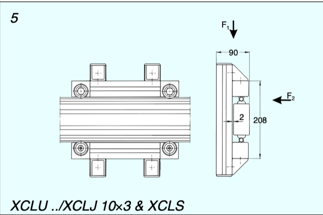  
> While the same wheels mounted into a structure of four to an XCBM 44 beam can take 80 kg (800 N)?

> "*An alternative is to mount the wheel into the wheel yoke which can be mounted either on the beam side or at the end of an XCBM 44 beam. The guide wheel is designed to run directly in the T-slot.*"

4) Consider

==&gt; Consider 500 kg load capacity Track Roller PR12 for 12 mm shaft (<https://www.dold-mechatronik.de/Track-Roller-PR12-for-shaft-12mm> )?

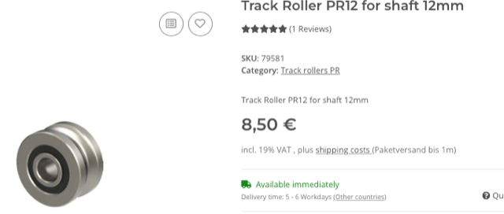

  
> *"load dynamically Cw: 8300N *  
> *load statically Cow: 5000N"*

>   
> PR12 runs on a 12 mm shaft and mounts on a 10 mm axel.

==&gt; Consider the concentric mouning bush for PR12 (<https://www.dold-mechatronik.de/Mounting-set-KLR12-PR12-concentric-clamping-bush> )?

> 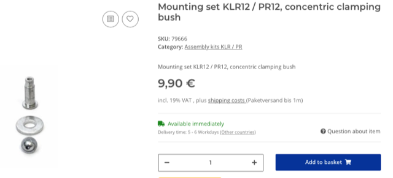

==&gt; Consider the 1,5 m long SBS12 shaft (<https://www.dold-mechatronik.de/Linear-guide-rail-Supported-SBS12-1500mm-long> )?

> 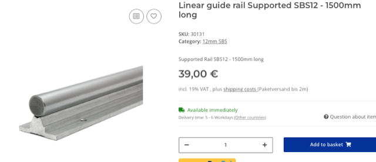

...


