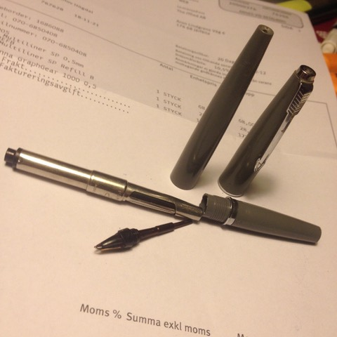
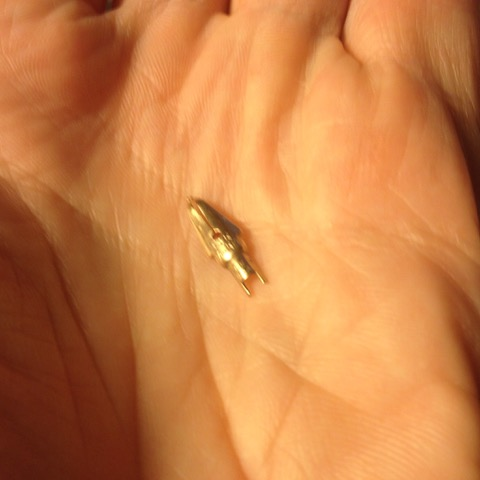
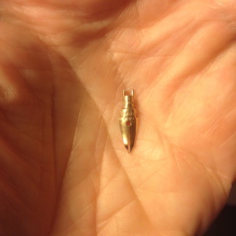

# Todo: Consider to fix up my fathers Parker 45 grey plastic fountain pen?

```#1f1db517``` *As of 2018-12-03 01:43*

[mail plain/text](mail.txt)


It seems the fountain pen I inherited from my father is a Parker 45?

1) Consider the grey fountain pen I inherited from my father is a parker 45?



==&gt; Consider this page that seems to indicate that the pen I have is a “Basic” Parker 45 CT (1964) (<http://parker45pens.com/models/>)?


> “Parker 45 Arrow or CT (Chrome Trim) – Plastic barrel, shell section and cap, silver (chrome) trim. Introduced in 1962 as the Parker 45 “Arrow” which later became the Parker 45 CT with some examples being marked as “45 School”."

==&gt; Consider this web URL sith seemingly ALL parker models through time that also seem to confirm that I have a Parker 45 CT (<https://parkerpens.net/parker45.html>)?


==&gt; It seems Parker 45 CT actually originally was designed as a “cheap” school pen and was introduced 1962?

> “The Parker "45" was initially a low-priced pen, eventually made in many colours, and finishes, one of Parkers great survivors."

> “The so called Parker 45 CT (aka Arrow), was introduced in 1962, was a breakthrough that economized production costs. The Parker "45" Arrow didn't have the steel cap, but was solely made out of plastic. This made production cheaper, partly beacuse metal was more expensive than plastic, but also because of a new production process. It was continually produced in the standard colours. Since the Parker 45 sold surprisingly well Parker realised that the pen might have more potential than just as a cheap school pen"

==&gt; I seem to have the “Shool” aka a late Parker 45 Arrow (also CT) (<https://parker45pens.wordpress.com/models/>)?

> “Parker 45 Arrow or CT (Chrome Trim) - Plastic barrel, shell section and cap, silver (chrome) trim. Introduced in 1962 as the Parker 45 "Arrow" which later became the Parker 45 CT with some examples being marked as "45 School". "


2) Consider this page that seems to describe replacement Nibs and how to disassembly the Parker 45 Nib (<http://parker45pens.com/nibs/>)?


3) Consider this youtube video “” on how to disassembly the Parker 45 (<https://www.youtube.com/watch?v=lUNqdM4GPvA&t=26s>)?

…

4) My nib seems a little bent but 14k gold and made in USA?

==&gt; But my nib markings (nor shape) seems to fit the shown information on <http://parker45pens.com/nibs/> ?



==&gt; It seems my tip is simply bent in that the slit for the ink should actually be staring and level all the way (<https://youtu.be/ODLDwQoBn6Q?t=336>)?


…

Consider to try and make the pen work again (in memory and honor to my father - the thinker and maker)?


